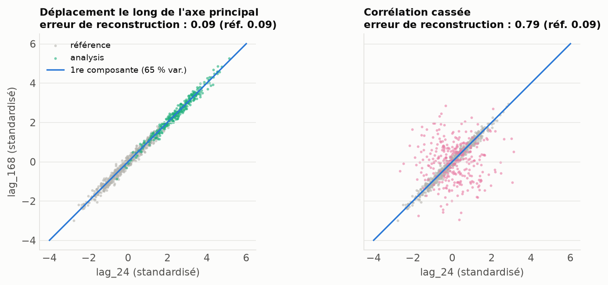

## Le principe

On ajuste une PCA sur la référence standardisée en gardant 65 % de la variance. Pour
chaque ligne de l'analysis, on la projette sur ce sous-espace puis on la reconstruit ;
l'**erreur de reconstruction** est la distance entre la ligne et sa reconstruction. Une
ligne « du même monde » que la référence se reconstruit bien ; une ligne dont la
structure jointe est inédite se reconstruit mal.

$$
e(x) = \big\lVert z - W W^\top z \big\rVert_2, \qquad z = \frac{x - \mu_R}{\sigma_R}
$$

où W contient les composantes retenues. Le score d'un chunk est la moyenne de e(x) ;
l'alerte se déclenche au-delà de la moyenne des chunks de référence plus trois écarts-types.

## Ce qu'elle voit, ce qu'elle ne voit pas

{#fig-pca fig-alt="Deux nuages de points de lag_168 contre lag_24 standardisés, avec la première composante principale en diagonale. À gauche, l'analysis s'étire le long de la diagonale : erreur de reconstruction 0,09, comme la référence. À droite, l'analysis s'écarte de la diagonale : erreur de reconstruction 0,79."}

Dans un panel de demande, les lags 24, 48, 72, 168, 336 h et les moyennes glissantes sont
**très corrélés** : la première composante est, à peu près, « le niveau de la zone ». Un
choc de demande (COVID, nouvelle taxe) déplace tous les lags dans le même sens, donc **le
long de cette composante**. La PCA sait reconstruire ce point, même très loin de la
référence : l'erreur de reconstruction reste plate.

::: {.callout-important}
## Résultat sur données réelles (E1)
Pendant le choc COVID, le volume de courses est divisé par plus de dix, et l'erreur de
reconstruction PCA reste **sous son seuil presque tous les jours**. Les tests univariés
sur les lags, eux, saturent. Ce n'est pas un bug : c'est la géométrie de la méthode.
:::

## Ce que le projet en fait

1. **Un test fige la limite** :
   `test_pca_reconstruction_sees_broken_correlation_but_not_shift_along_it` construit les
   deux cas de la figure et vérifie que seule la corrélation cassée déclenche une alerte.
2. **Le signal de dérive combine PCA et PSI** (`alerting.daily_signals`) :
   `drift = alerte PCA OU max(PSI) > 0,25`. La PCA couvre les ruptures de structure, le
   PSI les déplacements de niveau.
3. **La PCA reste utile** pour ce qu'elle fait bien : une zone dont le profil horaire
   change de forme (par exemple un pic du soir qui disparaît) casse la corrélation entre
   `lag_24` et `lag_168` sans forcément déplacer le niveau moyen.

## Alternatives écartées

| Méthode | Avantage | Pourquoi pas ici |
|---|---|---|
| Distance de Mahalanobis au centre de la référence | voit les déplacements le long des composantes | très sensible aux saisons, alerte permanente |
| Classifieur de domaine (NannyML) | voit presque tout | AUROC difficile à traduire en impact ; coût d'entraînement par chunk |
| MMD (noyau) | test à deux échantillons général | choix du noyau, coût quadratique |

La combinaison PCA + PSI est un compromis lisible : deux scores, deux types de dérive,
une règle explicite.
