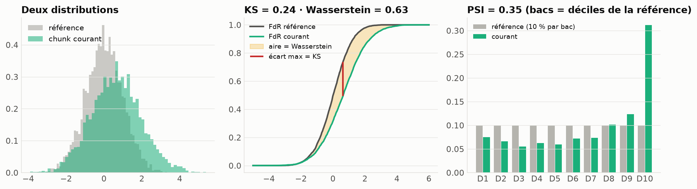

{#fig-univ fig-alt="Deux fonctions de répartition superposées, avec l'écart vertical maximal marqué (KS), l'aire entre les courbes ombrée (Wasserstein), et un diagramme en barres des parts par décile de la référence (PSI)."}

## Trois questions différentes

| Statistique | Question posée | Unité | Sensible à |
|---|---|---|---|
| **Kolmogorov-Smirnov** | quel est le plus grand écart entre les deux fonctions de répartition ? | sans unité, dans [0, 1] | tout changement de forme, surtout au centre |
| **Wasserstein (W1)** | combien de « masse » faut-il déplacer, et sur quelle distance, pour transformer une distribution en l'autre ? | **unité de la feature** | les déplacements, y compris dans les queues |
| **PSI** | la répartition dans des bacs fixes (déciles de la référence) a-t-elle changé ? | sans unité | les changements de proportions, robuste mais dépendant du découpage |

$$
\mathrm{PSI} = \sum_{b=1}^{B} (c_b - r_b)\,\ln\frac{c_b}{r_b}
$$

où r_b et c_b sont les parts de la référence et du chunk courant dans le bac b. Repères
d'usage : **< 0,1** stable, **0,1 à 0,25** dérive modérée, **> 0,25** dérive forte.

## Ce qu'il faut savoir avant de les brancher sur une astreinte

1. **Avec 1 440 lignes par jour, tout est significatif.** Un test KS sur de gros chunks
   rejette l'égalité pour des écarts sans aucune importance pratique. NannyML compare
   donc la statistique à la variabilité observée **entre chunks de référence**, plutôt
   qu'à une p-valeur.
2. **Les features calendaires dérivent par construction.** La part de jours fériés
   d'une semaine de décembre n'a rien à voir avec celle d'une semaine de septembre ;
   la température de janvier non plus. Une dérive de calendrier ou de météo est
   **attendue**, rarement nuisible : c'est la première source de fausses alertes
   mesurée dans [E1](../experiences/e1-covid.qmd). Pour une feature exogène saisonnière,
   comparer la moyenne du jour aux mêmes semaines de l'année précédente (z-score
   saisonnier) supprime ce bruit ; le PSI d'une journée contre une fenêtre longue, lui,
   reste mal posé ([E7](../experiences/e7-saisonnier.qmd)).
3. **Wasserstein parle la langue de la feature.** Un W1 de 0,4 sur `lag_168` (en log1p)
   veut dire « la demande d'il y a une semaine s'est déplacée d'environ 40 % en moyenne »,
   interprétable sans tableau de seuils.
4. **Univarié = aveugle à la structure.** Deux features qui cessent d'être corrélées sans
   que leurs marginales bougent passent inaperçues : c'est le rôle de la
   [dérive multivariée](derive-multivariee.qmd).

## Dans le code

```python
from zonefleet.monitoring import univariate_drift, daily_psi, psi

u = univariate_drift(reference, analysis)             # KS et Wasserstein, NannyML
p = daily_psi(reference, analysis, ["lag_24", "lag_168", "roll_mean_168", "temperature_2m"])
psi(reference["lag_168"], analysis["lag_168"])       # un PSI ponctuel
```

Le PSI est implémenté à la main (bacs = quantiles de la référence, plancher `eps` pour les
bacs vides) et testé : nul sur deux échantillons identiques, croissant avec le décalage,
supérieur à 0,25 pour un décalage d'un écart-type.
