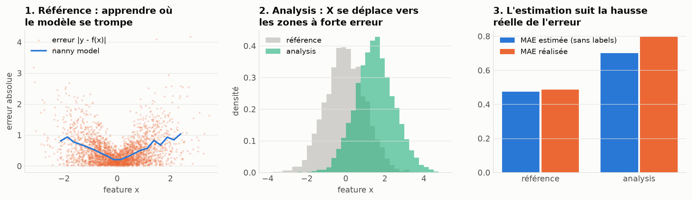

## L'intuition en trois images

{#fig-dle}

1. **Sur la référence**, chaque observation a une erreur connue. Un second modèle, le
   *nanny model*, apprend à prédire cette erreur à partir des entrées et de la prédiction.
2. **Sur l'analysis**, on ne connaît pas l'erreur, mais on connaît les entrées. Si elles
   se déplacent vers des régions où l'erreur était forte, le nanny model le sait.
3. **La moyenne par chunk** des erreurs prédites donne la MAE estimée, comparée à la MAE
   réalisée une fois les labels arrivés.

## Formellement

Soit f le forecaster figé, ℓ la perte (absolue pour la MAE, carrée pour la RMSE).
Sur la référence R, on ajuste

$$
\hat g = \arg\min_g \sum_{i \in R} \big( g(x_i, f(x_i)) - \ell(y_i, f(x_i)) \big)^2
$$

puis, pour un chunk C de l'analysis :

$$
\widehat{\mathrm{MAE}}(C) = \frac{1}{|C|} \sum_{i \in C} \hat g\big(x_i, f(x_i)\big),
\qquad
\widehat{\mathrm{RMSE}}(C) = \sqrt{\frac{1}{|C|} \sum_{i \in C} \hat g_2\big(x_i, f(x_i)\big)}
$$

L'estimateur est sans biais si E[ℓ | X, f(X)] est la même sur R et sur C, c'est-à-dire si
**P(y | X) n'a pas changé**. C'est l'hypothèse « pas de concept drift », vue sous l'angle
de l'espérance conditionnelle : DLE ne réévalue jamais la carte ĝ, il la **lit** à de
nouvelles positions.

## Ce que DLE voit et ne voit pas

| Situation | Effet sur ĝ | Estimation |
|---|---|---|
| X se déplace dans des régions **connues** où l'erreur diffère | lecture de ĝ à d'autres endroits | **fiable** |
| X sort du support de la référence (valeurs jamais vues) | extrapolation de LightGBM (constante aux bords) | **biaisée**, en général sous-estimée |
| P(y \| X) change, X stable | ĝ inchangée, lue aux mêmes endroits | **aveugle** |
| Bruit homoscédastique (erreur identique partout) | ĝ quasi constante | estimation plate, toute variation est du bruit |

## Lire DLE par zone

La perte estimée par ligne s'agrège aussi par zone : elle sert alors de **diagnostic**.
Sur le COVID, elle classe les zones touchées presque comme l'erreur réalisée
(corrélation de rang 0,74), même quand elle sous-estime l'ampleur ([E6](../experiences/e6-localisation.qmd)).

## Deux échelles, deux lectures

Le projet estime la performance sur deux échelles :

- **count** : MAE en courses. C'est la lecture métier (« combien de véhicules de trop
  ou de trop peu »), mais elle suit le niveau de la demande.
- **log** : MAE sur log1p. Une erreur de 0,2 signifie environ 20 % d'écart relatif,
  quelle que soit la taille de la zone. C'est l'échelle de détection retenue par les
  politiques d'alerte (voir [métriques](metriques.qmd)).

## Dans le code

```python
from zonefleet.monitoring import estimate_performance, realized_performance

est = estimate_performance(reference, analysis, scale="log", metrics=("mae", "rmse"))
# colonnes : date, metric, estimated, lower, upper, threshold, alert
real = realized_performance(analysis, scale="log")  # seulement quand les labels arrivent
```

Points d'implémentation :

- `estimate_performance` ne transmet à NannyML que `ts`, les features et `y_pred` de
  l'analysis ; le test `test_dle_never_sees_analysis_labels` le vérifie avec des labels `NaN`.
- Le nanny model voit la zone (catégorielle) : l'erreur d'une zone de Midtown n'a pas la
  même distribution que celle d'Astoria.
- La graine du nanny model est fixée (`random_state`) pour que les tables de `results/`
  soient reproductibles.
- Le seuil d'alerte est celui de NannyML : moyenne des chunks de référence plus trois
  écarts-types. Il n'est jamais saisi à la main (Sculley, « fixed thresholds »).
