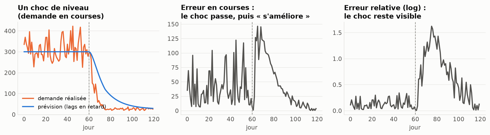

## Le paradoxe de la MAE absolue

{#fig-scales fig-alt="Trois courbes sur 120 jours avec un choc au jour 60. La demande réalisée chute de 300 à environ 30 courses, la prévision la suit avec retard. L'erreur en courses bondit au choc puis décroît vers zéro. L'erreur relative en log bondit au choc et reste élevée plusieurs semaines."}

Quand la demande d'une zone passe de 300 à 30 courses par heure, une erreur de 50 % ne
pèse plus que 15 courses au lieu de 150. La MAE en courses **baisse**, le modèle est
pourtant devenu inutile. Les données réelles de E1 montrent exactement ce comportement :
au plancher du COVID (avril à juin 2020), la MAE réalisée en courses tombe à 3,5 contre
20,6 avant le choc, alors que l'erreur relative a triplé.

## Les métriques du projet, et à quoi elles servent

| Métrique | Formule | Rôle |
|---|---|---|
| MAE (count) | moyenne de \|y - ŷ\| | lecture métier : véhicules en trop ou manquants |
| RMSE (count) | racine de la moyenne de (y - ŷ)² | pénalise les grosses erreurs (zones denses, pics) |
| **MAE (log)** | moyenne de \|log1p y - log1p ŷ\| | **échelle de détection** : ≈ erreur relative, comparable entre zones et entre régimes |
| sMAPE | 200 · \|y - ŷ\| / (\|y\| + \|ŷ\|) | lecture relative, terme nul quand y = ŷ = 0 |
| MASE | MAE / MAE du seasonal naive (lag 168 h) sur l'entraînement | compare au « modèle sans modèle » ; **échelle figée** |
| Pinball moyen | perte quantile aux niveaux 0,1 ; 0,5 ; 0,9 | qualité des quantiles (positionnement sous incertitude) |
| Couverture 80 % | part des y dans [q10, q90] | calibration de l'intervalle |

::: {.callout-note}
## Pourquoi figer l'échelle du MASE
Si l'échelle du MASE était recalculée sur chaque période, elle baisserait avec le volume
pendant un choc et masquerait la dégradation, exactement comme la MAE absolue. Elle est
donc calculée **une fois**, sur l'entraînement de chaque expérience, et stockée dans le
cache (`pipeline.mase_scale`).
:::

## Pourquoi DLE est lancé sur deux échelles

DLE estime l'espérance d'une perte. Sur l'échelle count, la perte dépend surtout du
**niveau** de la prévision : le nanny model apprend « grosse prévision, grosse erreur ».
Pendant un effondrement, il lit des prévisions plus petites et prédit des erreurs plus
petites, ce qui est vrai en valeur absolue et trompeur en pratique.

Sur l'échelle log, la perte est déjà relative ; le nanny model apprend où le modèle se
trompe *proportionnellement*. C'est cette estimation que les politiques d'alerte
utilisent (`metric="mae_log"` dans `alerting.daily_signals`). L'échelle count reste
publiée pour la lecture métier.
