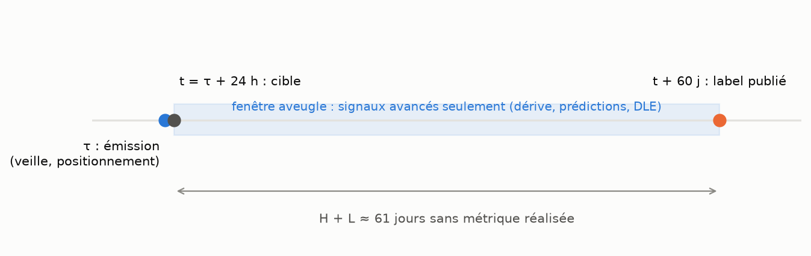

## Une prévision vit sur trois horloges

{#fig-clocks}

| Horloge | Notation | ZoneFleet | Ce qui est connu |
|---|---|---|---|
| Émission | τ | la veille, au moment de positionner la flotte | les features : lags, calendrier, météo prévue |
| Cible | t = τ + H | l'heure prévue, **H = 24 h** | la demande se produit, mais personne ne la mesure encore pour le modèle |
| Label | t + L | publication TLC, **L ≈ 60 jours** | la vérité terrain, enfin comparable à la prévision |

Entre τ et t + L, la seule information disponible sur la santé du modèle vient de ce qu'il
**voit** (ses entrées) et de ce qu'il **dit** (ses prédictions). C'est la **fenêtre
aveugle** : environ 61 jours pour chaque prévision.

## Conséquence 1 : aucune feature ne peut regarder à moins de H

Si la prévision de 18 h demain est émise à 18 h aujourd'hui, la demande de 17 h demain est
inconnue. D'où la règle de conception, appliquée et testée dans `features.py` :

- tous les lags de demande sont **≥ 24 h** (24, 48, 72, 168, 336) ;
- les moyennes glissantes **se terminent à t - 24 h** ;
- la fonction `add_lag_features` lève une erreur si un lag inférieur à l'horizon est
  configuré (test `test_short_lag_is_rejected`).

::: {.callout-warning}
## Le piège classique
Un lag de 1 h dans un modèle « à horizon 24 h » donne d'excellents backtests et un modèle
inutilisable : en production, la valeur n'existe pas au moment de l'émission. Ce n'est
pas un problème de monitoring, c'est une fuite ; mais elle rend tout monitoring absurde,
car la référence est alors calculée sur une performance impossible.
:::

## Conséquence 2 : un délai de détection se rapporte sur l'horloge de décision

Un signal sur le jour cible D n'est pas disponible au même moment selon sa nature :

| Signal | Disponible à | Pourquoi |
|---|---|---|
| Dérive des entrées du jour D | D - 1 jour (émission) | les features sont connues à τ |
| Dérive des prédictions du jour D | D - 1 jour | la prévision existe dès son émission |
| Performance **estimée** (DLE) du jour D | D - 1 jour | DLE n'utilise que features et prédictions |
| Performance **réalisée** du jour D | D + 60 jours | il faut le label publié |

Ce projet mesure donc chaque délai de détection **sur l'horloge de décision** (fonction
`alerting.decision_time`). La même discipline s'applique aux outils d'exploitation : le
[rapport du matin](../exploitation/rapport.qmd) masque, dans un rejeu historique, toute
perte réalisée dont la publication est postérieure à sa date. Une alerte sur la performance réalisée qui pointe le bon jour
cible arrive deux mois trop tard pour repositionner une flotte : elle n'a de valeur que
pour l'audit et le réentraînement.

```{mermaid}
gantt
  dateFormat  YYYY-MM-DD
  axisFormat  %d %b
  title Choc COVID : quand chaque politique aurait pu alerter (E1)
  section Monde
  Etat d'urgence NY (13 mars)         :milestone, m1, 2020-03-13, 0d
  section Signaux avancés
  DLE seul, P2 (décision 22 mars)      :done, p2, 2020-03-13, 2020-03-22
  Dérive ET DLE, P3 (décision 22 mars) :done, p3, 2020-03-13, 2020-03-22
  section Labels
  Performance réalisée, P4 (14 mai)    :crit, p4, 2020-03-13, 2020-05-14
```

## Conséquence 3 : la référence doit être hors échantillon

La performance de référence, celle à laquelle toute dérive est comparée, doit être mesurée
là où le modèle n'a **pas** appris. Sinon le moniteur compare l'analysis à une erreur
d'entraînement optimiste et voit une « dégradation » dès le premier jour. Le
[SPEC](https://github.com/gwils28/zonefleet-observability/blob/main/SPEC.md) découpe donc
chaque expérience en trois périodes : entraînement, **référence hors échantillon**, analysis.

| Expérience | Entraînement | Référence | Analysis |
|---|---|---|---|
| E1 COVID | janv.-août 2019 | sept.-déc. 2019 | janv.-juin 2020 |
| E2 congestion | janv.-août 2024 | sept.-déc. 2024 | janv.-juin 2025 |
