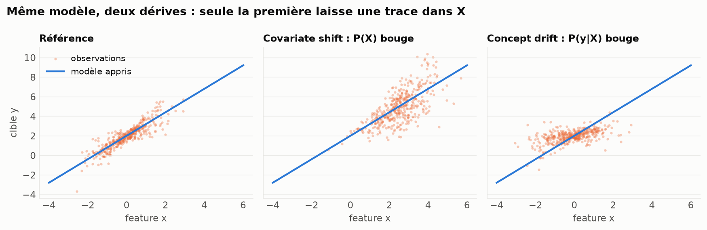

## Trois façons pour le monde de changer

Un modèle apprend une relation entre des entrées X et une cible y, à partir de la loi
jointe P(X, y) = P(y | X) · P(X). Chacun des deux termes peut bouger.

{#fig-drift-types fig-alt="Trois nuages de points de la cible en fonction d'une feature, avec la même droite de modèle. Référence : les points suivent la droite. Covariate shift : les points se déplacent vers la droite du graphique en restant près de la droite. Concept drift : les points restent au même endroit mais s'aplatissent sous la droite."}

| Dérive | Ce qui change | Trace dans X ? | Exemple ZoneFleet |
|---|---|---|---|
| **Covariate shift** | P(X), avec P(y \| X) stable | **oui** | vague de chaleur, mix de zones différent, saison jamais vue |
| **Prior shift** (*label shift*) | P(y), avec P(X \| y) stable | indirecte | hausse générale de la demande, que les lags finissent par refléter |
| **Concept drift** | P(y \| X) | **non** (pur) | même heure, même météo, même historique, mais la taxe de congestion fait baisser la demande |

## Pourquoi la distinction est décisive en production

Sans labels, on ne dispose que de X et des prédictions f(X). Donc :

- un **covariate shift** est **détectable** (dérive des entrées) et, si le modèle a des
  régions d'erreur hétérogènes, son **impact est estimable** (DLE, voir
  [mécanisme](dle.qmd)) ;
- un **concept drift pur** est **invisible** : X ne bouge pas, f(X) non plus, l'erreur
  estimée non plus ; seule l'erreur réalisée, deux mois plus tard, le révélera.

```{mermaid}
flowchart TD
  A{"Les entrées X<br/>ont-elles bougé ?"} -- oui --> B{"Vers des régions<br/>où le modèle se trompe<br/>davantage ?"}
  A -- non --> C["Rien de visible sans labels<br/><b>concept drift pur : angle mort</b>"]
  B -- oui --> D["Dérive + hausse de l'erreur estimée<br/><b>alerte justifiée</b>"]
  B -- non --> E["Dérive sans impact<br/><b>fausse alerte si l'on alerte sur la dérive seule</b>"]
  C --> F["Filet de sécurité :<br/>performance réalisée, retardée de L"]
```

## Le cas particulier des forecasters à lags

Dans un modèle à lags, la frontière est **mouvante**, et c'est ce qui rend le sujet subtil.

1. **Jour 0 du choc** : la demande s'effondre, mais les lags (≥ 24 h) décrivent encore
   l'avant-choc. X est normal, y ne l'est plus : du point de vue du modèle, c'est un
   **concept drift pur**. DLE ne voit rien.
2. **Jours 1 à 14** : les lags 24, 48, 72 h puis 168 h basculent dans le nouveau régime ;
   X se déplace vers des valeurs basses, parfois **jamais vues** dans la référence
   (hypothèse 2 de DLE violée). La dérive devient visible, l'estimation devient une
   extrapolation.
3. **Après deux semaines** : tous les lags reflètent le nouveau niveau. Le problème
   ressemble à un covariate shift, mais la relation apprise (par exemple « le lundi matin
   vaut 1,3 fois le dimanche ») peut elle-même avoir changé : concept drift résiduel.

Cette séquence est visible dans les données réelles de [E1](../experiences/e1-covid.qmd)
et isolée proprement, type par type, dans [E3](../experiences/e3-frontiere.qmd). Elle vaut
aussi à petite échelle : parmi les dérives nuisibles limitées à quelques zones, presque
toutes sont des concept drifts, invisibles à la ville comme à la zone ([E10](../experiences/e10-zones.qmd)).

## Construire des dérives pures pour les tester

Sur données réelles, les dérives sont toujours mêlées. Pour tester l'hypothèse « DLE suit
le covariate shift et ment sous concept drift », E3 les **construit** sur la période calme :

| Dérive construite | Procédé | Garantie par construction |
|---|---|---|
| Covariate shift pur | sous-échantillonnage pondéré de lignes **réelles** (on sur-représente certaines heures, zones ou niveaux) | chaque ligne garde son vrai couple (X, y) : P(y \| X) intact |
| Concept drift pur | y multiplié sur un sous-ensemble de lignes, **X gelé** | aucune ligne ne change d'entrées : P(X) intact |
| Choc de niveau propagé | y **et** les lags multipliés ensemble (après le délai de chaque lag) | cas réaliste, mêlé |
