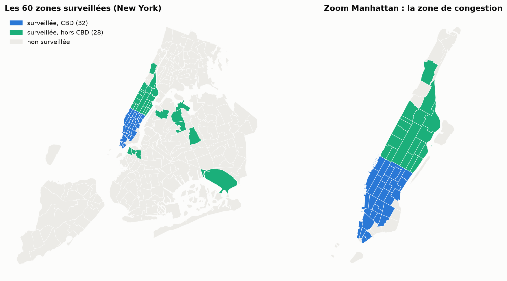
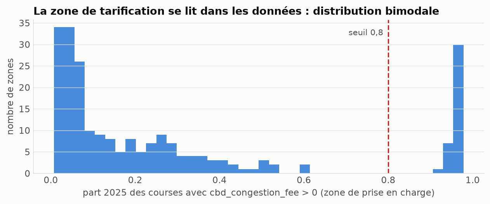
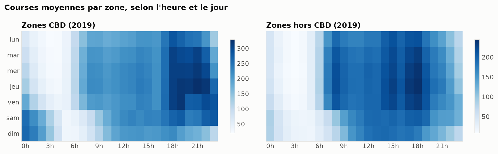
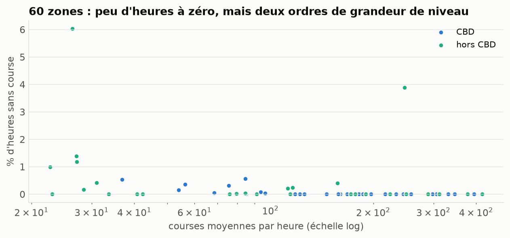

## De la course au panel

```{mermaid}
flowchart LR
  A["96 Parquet TLC<br/>(jaunes, verts)"] --> B["data contract<br/>(schéma seul)"]
  B -->|conforme| C["duckdb : COUNT(*)<br/>par zone x heure"]
  B -->|violation| X["fichier refusé"]
  C --> D["filtre : heure dans le mois du fichier,<br/>zones 1 à 263"]
  D --> E["60 zones les plus actives en 2019"]
  E --> F["grille complète, zéros explicites"]
  F --> G["réparation DST"]
  G --> H["panel.parquet<br/>2 105 280 lignes"]
```

L'agrégation des 96 fichiers prend environ 5 secondes avec duckdb (lecture colonnaire
des seules colonnes utiles). Les courses dont l'horodatage sort du mois du fichier
(horloges de taximètre déréglées, fréquentes dans TLC) sont écartées.

## 60 zones, figées une fois pour toutes

Les zones retenues sont les **60 plus actives en 2019** (jaunes et verts confondus).
Elles concentrent 93 % des courses de 2019 (`data_summary.csv`). La liste est figée dans
`configs/zones.yaml` : la recalculer sur 2025 changerait l'objet surveillé en même temps
que le monde, et rendrait les comparaisons impossibles.

{#fig-map}

### L'indicateur CBD se lit dans les données

Plutôt que de recopier une liste officielle de zones, on mesure, pour chaque zone de
prise en charge, la part des courses 2025 avec `cbd_congestion_fee > 0`. Une course qui
**commence** dans la zone tarifée paie toujours : une zone intérieure a une part proche
de 1.

{#fig-cbd}

Les zones CBD ont toutes une part supérieure à 0,93 ; les autres restent sous 0,6. Le
seuil de 0,8 ne tombe sur aucune zone : la classification est robuste.

## Profils et niveaux

{#fig-profiles}

{#fig-levels}

Deux conséquences pour la modélisation :

- **cible en log1p** : l'erreur d'une zone à 400 courses par heure ne doit pas écraser
  celle d'une zone à 25 ; log1p rend les erreurs comparables et gère les rares zéros ;
- **modèle global** avec la zone en variable catégorielle, plutôt que 60 modèles locaux :
  plus de données par paramètre, et un seul objet à surveiller.

## Les heures qui n'existent pas

Les horodatages TLC sont en heure locale **naïve**. Deux fois par an, cela crée un artefact :

| Transition | Heure concernée | Symptôme | Réparation |
|---|---|---|---|
| Printemps (mars) | 02:00 n'existe pas | presque aucune course enregistrée | moyenne des heures voisines |
| Automne (novembre) | 01:00 existe deux fois | volume doublé | volume divisé par deux |

Huit heures par zone sont concernées sur les quatre années, marquées par la colonne
`dst_repaired`. La météo, récupérée en UTC, est ramenée sur la même convention (moyenne
des deux heures d'automne, interpolation au printemps) pour que les jointures soient
exactes. Les deux réparations sont testées (`test_spring_forward_hour_is_interpolated`,
`test_fall_back_hour_is_halved`).

## Contrôles

`data.check_panel` refuse un panel avec doublons zone x heure, volumes négatifs, volume
supérieur au plafond du contrat (3 000 courses par zone et par heure), ou zones de
longueurs différentes. Le panel versionné (`data/processed/panel.parquet`, 10 Mo) évite
de retélécharger 3 Go pour reproduire les expériences.

## Les 60 zones

::: {.callout-note collapse="true"}
## Afficher la table des zones

:::
