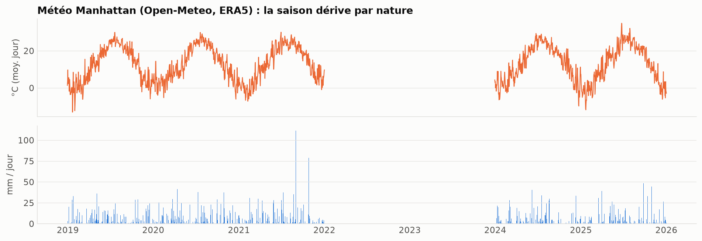

## NYC TLC Trip Record Data

La [Taxi & Limousine Commission](https://www.nyc.gov/site/tlc/about/tlc-trip-record-data.page)
publie chaque mois, au format Parquet, une ligne par course : horodatages de prise en
charge et de dépose, zones de départ et d'arrivée (`PULocationID`, `DOLocationID`),
distance, tarif et suppléments. Les fichiers paraissent avec environ **deux mois de
décalage** : c'est le L = 60 jours de nos [trois horloges](../concepts/trois-horloges.qmd).

| Choix | Valeur | Raison |
|---|---|---|
| Services | taxis jaunes et verts | volumes TLC historiques ; les VTC (FHVHV, ~0,5 Go par mois) sont hors périmètre |
| Années | 2019-2021, 2024-2025 | deux ruptures réelles, le COVID (mars 2020) et la tarification de congestion (5 janvier 2025), et la reprise de 2021 (ajoutée en août) |
| Fichiers | 120 Parquet, 3,6 Go | `make data`, empreintes SHA-256 vérifiées (`configs/manifest_sha256.txt`) |
| Granularité | zone de prise en charge x heure locale | maille du positionnement de flotte |

{#fig-volumes fig-alt="Deux panneaux de courbes de courses journalières en milliers (moyenne 7 jours), taxis jaunes et verts. 2019-2021 : environ 200 000 courses jaunes par jour, chute brutale le 13 mars 2020 vers moins de 10 000, puis remontée lente jusqu'à environ 100 000 fin 2021. 2024-2025 : entre 80 000 et 160 000, sans rupture à la tarification de congestion du 5 janvier 2025. Les taxis verts restent proches de zéro."}

::: {.callout-note}
## Deux ruptures de nature très différente
Le COVID est un **effondrement global** : 9 000 courses par jour en moyenne en avril 2020,
contre 229 000 en février (`results/tables/data_summary.csv`). La tarification de
congestion est une **modification locale** : à l'échelle de la ville, février 2025
(129 000 courses par jour) dépasse décembre 2024 (120 000). Si elle déplace la demande,
c'est entre zones et entre heures, ce qu'[E2](../experiences/e2-congestion.qmd) examine.

La **reprise de 2021** est lente et partielle : en décembre 2021, le volume quotidien
(106 000 courses) n'atteint que 45 % de celui de décembre 2019. C'est une dérive de sens
inverse, progressive, utilisée par [E5 bis](../experiences/e5-reentrainement.qmd).
:::

Le poids des taxis verts s'effondre entre les deux périodes : 7 % des courses en 2019,
1,2 % en 2025. Le panel additionne les deux services, mais cette recomposition est un
exemple de **changement de population** que le monitoring doit tolérer.

## Taxi Zone Lookup Table et contours

263 zones numérotées (plus deux codes « inconnu », écartés), rattachées à un
arrondissement. Le shapefile des contours sert uniquement aux cartes de la documentation.

## Météo : Open-Meteo (archive ERA5)

Température à 2 m et précipitations horaires au point de Times Square, via
l'[API d'archive Open-Meteo](https://open-meteo.com/en/docs/historical-weather-api),
récupérées en UTC puis ramenées en heure locale sur la même convention que les courses.
Cache versionné : `data/processed/weather.csv` (35 184 heures, aucune valeur manquante).

{#fig-weather fig-alt="Deux séries journalières de 2019 à 2025, sans données en 2022 et 2023 : température moyenne, avec un cycle saisonnier entre environ -5 et 30 degrés, et précipitations en barres, la plupart sous 25 mm par jour avec quelques pics au-delà de 75 mm."}

::: {.callout-warning}
## Hypothèse optimiste assumée, puis levée
La météo **réalisée** tient lieu de prévision météo à 24 h. En production, on utiliserait
une prévision (erreur de quelques degrés, timing des averses incertain).
[E9](../experiences/e9-meteo.qmd) l'a vérifié après coup avec la prévision réellement émise
la veille : 1,5 °C d'erreur moyenne, mais une MAE du modèle qui ne bouge que de 0,1 %.
:::

## Calendrier

Heure, jour de semaine, week-end, jours fériés fédéraux US et observés (paquet
`holidays`). Les features de saison (jour de l'année en sinus et cosinus) sont calculées
mais **exclues du modèle** : voir [features](../modele/features.qmd).

## Ce que les données ne contiennent pas

- **La demande non servie.** TLC enregistre des courses, pas des demandes. Une zone sans
  taxi disponible a une demande observée nulle. Pour ZoneFleet, c'est la porte d'entrée
  des boucles de rétroaction (voir [Sculley](../veille/sculley.qmd)).
- **Les événements** (concerts, matchs, manifestations) : non intégrés, faute de source
  historique propre ; ils apparaissent comme des jours atypiques que la persistance des
  alertes (2 jours) absorbe.
