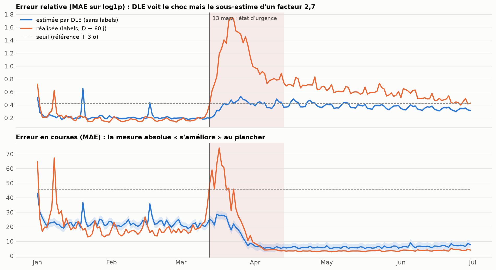
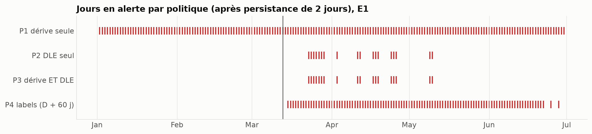
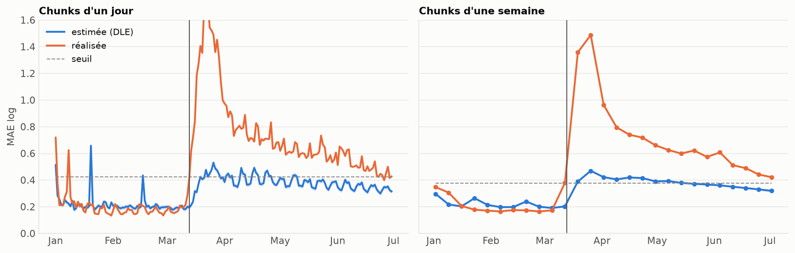

::: {.callout-note appearance="minimal"}
Script : `uv run python -m zonefleet.experiments.e1_covid` (≈ 10 s, modèle et prédictions
en cache) · tables : `results/tables/e1_*.csv` · référence sept.-déc. 2019 (hors
échantillon), analysis janv.-juin 2020, chunks journaliers de 1 440 lignes.
:::

## Le résultat en une figure

{#fig-e1}

::: {.callout-tip}
## Version interactive
Survoler pour lire les valeurs du jour.


:::



## Lecture : trois régimes

**Avant le choc (janvier au 12 mars).** DLE suit l'erreur réalisée de près en échelle log
(0,217 estimé contre 0,202 réalisé). Deux faux pics isolés (fin janvier, mi-février)
sont absorbés par la persistance de 2 jours.

**Le choc (13 mars au 12 avril).** L'erreur relative réalisée est multipliée par cinq
(1,10 en moyenne, jusqu'à 1,75). DLE **monte** (de 0,20 à 0,40), donc il voit quelque
chose, mais il reste à **37 % de la réalité**. C'est le régime du **concept drift vu depuis
le modèle** : pendant une à deux semaines, les lags décrivent encore le monde d'avant ; la
relation « mêmes entrées, même demande » est fausse et le nanny model, qui a appris sur
l'automne 2019, ne peut pas le savoir. Puis les entrées s'effondrent à leur tour vers des
niveaux **jamais vus** dans la référence : DLE extrapole, et LightGBM extrapole par une
constante.

**Le plancher (13 avril au 30 juin).** Les lags ont rattrapé le nouveau niveau ; l'erreur
relative réalisée redescend (0,59) mais reste trois fois supérieure à l'avant-choc.
DLE s'est stabilisé autour de 0,37 : il sous-estime encore (ratio 0,63), mais la
corrélation journalière avec le réalisé est la meilleure des trois phases (0,71).

::: {.callout-important}
## Où l'estimation décroche
DLE suit l'erreur tant que le monde reste dans le support de la référence (avant) et
retrouve une partie de sa capacité quand les lags ont absorbé le nouveau régime
(plancher). Il **décroche pendant la transition** : c'est le moment où la relation
X → y est cassée et où X lui-même sort du connu. La frontière est nommée et mesurée
proprement, type par type, dans [E3](e3-frontiere.qmd).
:::

{#fig-scatter}

## L'erreur en courses ment dans l'autre sens

En bas de la @fig-e1, la MAE en courses réalisée **baisse** au plancher (3,5 contre 20,6
avant le choc). DLE en courses la **surestime** (6,2) parce qu'il a appris « grosse
prévision, grosse erreur » et lit maintenant de petites prévisions, mais pas assez petites.
Ni l'une ni l'autre ne dit que le modèle est devenu inutile : il faut l'échelle relative.

## Ce que voit la dérive des entrées

{#fig-drift}

Trois enseignements :

1. **La température dérive en permanence** : une analysis d'hiver contre une référence
   d'automne. C'est la première source de fausses alertes de la dérive seule (PSI > 0,25
   **tous les jours** de l'analysis).
2. **La reconstruction PCA ne voit pas le choc** : son rapport au seuil reste sous 1
   presque tous les jours (alerte 2,7 % des jours), exactement comme prévu par
   l'analyse géométrique de la [dérive multivariée](../concepts/derive-multivariee.qmd).
3. **Les features calendaires ne doivent pas être testées par chunk journalier** : un jour
   contient un seul `dow`, la statistique est un artefact du découpage. Elles sont
   déterministes ; leur dérive n'apporte aucune information. À retirer des tests
   univariés en production (elles restent utiles dans la PCA, où elles structurent le
   nuage).

## Quand chaque politique aurait alerté



{#fig-alerts}

- **P1, dérive seule** : « alerte » le 12 mars, mais elle alertait déjà depuis 71 jours.
  Une alarme qui sonne tout le temps n'a pas de délai de détection, elle a un taux de
  fausses alertes de 100 %.
- **P2 et P3** : décision possible le **22 mars**, 9 jours après l'état d'urgence, sans
  aucune fausse alerte avant. Mais elles ne sont en alerte que **18 jours** sur les 102
  jours où l'erreur réalisée dépasse le seuil : leur rappel au jour près est faible,
  parce que DLE sous-estime.
- **P4, labels** : en alerte 102 jours sur 110, mais la première décision n'est possible
  que le **14 mai**.
- **P1b, dérive nettoyée** (PCA ou PSI sur `lag_24` et `lag_168` seulement, variante
  introduite pour E4) : décision le **14 mars**, un jour après l'état d'urgence, **sans
  aucune fausse alerte avant**. Retirer la température et la moyenne glissante suffit à
  transformer une alarme permanente en détecteur précoce. P3b (P1b ET DLE) décide le
  22 mars, comme P2 : sur ce choc, c'est DLE qui fixe le délai de la condition jointe.

::: {.callout-tip}
## Rejouer la page du 22 mars
Le notebook [anatomie d'une alerte](../notebooks/anatomie-alerte.ipynb) reprend ces
journées une à une : quel signal s'allume, quand, et ce que le rapport du matin aurait dit.
:::

## Ce que E1 établit

1. Sur un choc réel, **la performance estimée sans labels détecte en 9 jours ce que les
   labels détectent en 62**, sans fausse alerte, mais en sous-estimant l'ampleur.
2. La **condition jointe** ne coûte rien ici (P3 = P2) et ne gagne rien non plus : DLE n'a
   pas eu de faux positif à filtrer. Son intérêt apparaît sur un choc sans impact
   ([E2](e2-congestion.qmd)) et dans le backtest ([E4](e4-backtest.qmd)).
3. Une politique de production ne peut pas se reposer sur DLE seul pour l'**ampleur** :
   le chiffre estimé est un minorant pendant les ruptures.
4. La **dérive nettoyée** (lags seulement) détecte le choc en un jour sans fausse alerte
   préalable : elle ouvre un ticket le 14 mars, la condition jointe page le 22.

## Variante : chunks d'une semaine (E1 bis)

La taille du chunk est un réglage à part entière : plus grand, il réduit le bruit
d'échantillonnage ; plus long, il retarde la décision (une semaine n'est complète que
le dimanche). `e1_chunks.py` recalcule DLE sur des semaines calendaires (lundi à
dimanche), protocole déclaré dans l'issue #44.

{#fig-chunks}



- L'intervalle de confiance de DLE est **2,7 fois plus étroit** en semaines (3,7 % de
  l'estimation contre 9,9 %).
- **Sans persistance**, le chunk journalier décide plus tôt (18 mars) mais au prix de
  3 fausses alertes avant le choc ; le chunk hebdomadaire décide le 21 mars, sans fausse
  alerte. La surprise envisagée (une semaine plus rapide qu'un jour) ne se produit pas.
- Le chunk hebdomadaire se comporte comme le chunk journalier **avec 2 jours de
  persistance** (décision le 22 mars, 0 fausse alerte) : deux façons d'acheter de la
  robustesse avec quelques jours de délai. La persistance garde la granularité
  journalière utile au diagnostic ; c'est elle que retient la politique d'astreinte.
