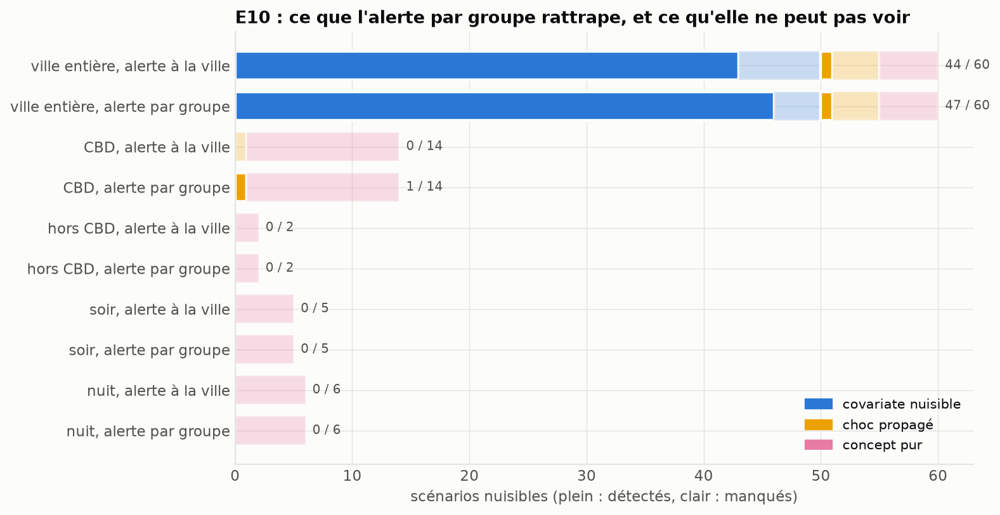

::: {.callout-note appearance="minimal"}
Script : `uv run python -m zonefleet.experiments.e10_zones` (≈ 2 min) · tables :
`results/tables/e10_*.csv` · protocole déclaré dans l'issue #80 · mêmes 240 scénarios,
même nuisance et mêmes injections que [E4](e4-backtest.qmd).
:::

## La question

E4 agrège tous les signaux à l'échelle de la ville. Une dérive limitée à quelques zones
(le CBD, la nuit, le soir) y est diluée par les 28 ou 32 zones qui ne bougent pas.
Évaluer la condition jointe **par groupe** (CBD, hors CBD), avec des seuils de référence
propres à chaque groupe, puis alerter si l'un des groupes alerte, détecte-t-il mieux ?

## Résultats



{#fig-e10}

- **Le rappel global passe de 51 % à 55 %, toujours sans fausse alerte.** Le gain vient
  de trois covariate shifts à l'échelle de la ville et du seul choc de niveau limité au
  CBD parmi les scénarios nuisibles, que la ville ne voyait pas.
- **Les dérives locales restent presque toutes manquées** (1 sur 27), et ce n'est pas un
  problème d'agrégation : **26 des 27 dérives locales nuisibles sont des concept drifts**,
  invisibles sans labels quelle que soit la maille ([E3](e3-frontiere.qmd)). Les chocs
  de niveau locaux sont, eux, rarement nuisibles sur 28 jours (le modèle à lags les
  absorbe).
- La surprise envisagée (aucun gain sur les dérives limitées au CBD) se produit presque :
  1 détection sur 14, la seule qui était observable.

## Ce que E10 établit

1. Alerter **aussi** par groupe de zones est gratuit (zéro fausse alerte) et rapporte un
  peu ; le coût est un calcul par groupe et des seuils par groupe.
2. Affiner la maille ne perce pas l'angle mort : une dérive locale de la relation entre
  entrées et demande reste invisible, à la ville comme à la zone.
3. Combiné à [E6](e6-localisation.qmd) (la perte estimée localise bien ce qu'elle voit),
  la recommandation est d'**alerter par groupe** et de **diagnostiquer par zone**.
