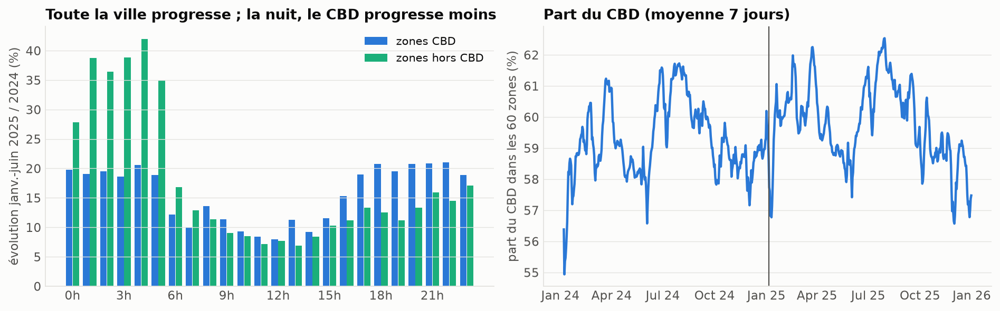
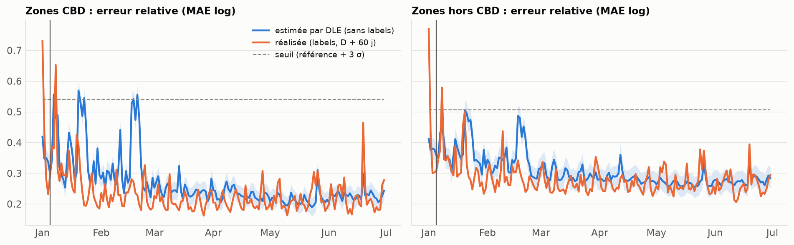
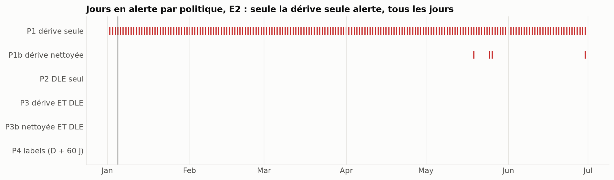
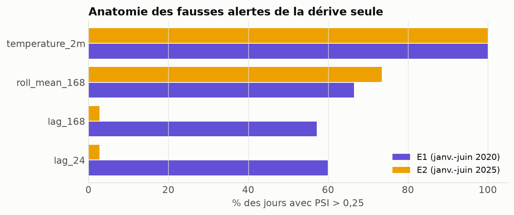

::: {.callout-note appearance="minimal"}
Script : `uv run python -m zonefleet.experiments.e2_congestion` (≈ 30 s) · tables :
`results/tables/e2_*.csv` · référence sept.-déc. 2024, analysis janv.-juin 2025,
monitoring global puis séparé pour les 32 zones CBD et les 28 zones hors CBD.
:::

## Le scénario ZoneFleet, confronté aux données

Le cahier des charges ZoneFleet suppose que la tarification de congestion « a déplacé la
relation entre features et demande ». C'est une hypothèse ; E2 la teste sur les vraies
courses de taxis jaunes et verts. Réponse courte : **la demande se recompose, mais le
modèle n'en souffre pas**.

## La demande a-t-elle bougé ?

{#fig-demand}

- Toute la ville progresse entre 2024 et 2025 (+7 à +42 % selon l'heure) : la reprise des
  taxis se poursuit, la taxe ne provoque **aucun effondrement**.
- **La nuit (1 h à 5 h), le CBD progresse de 16 à 21 points de moins** que le hors CBD ;
  le soir (17 h à 22 h), il progresse de 5 à 8 points de plus. C'est une
  **recomposition horaire**, compatible avec un effet de la taxe sur les trajets
  nocturnes, sans qu'on puisse l'attribuer causalement ici (la différence de différences
  ne contrôle pas les autres changements de 2025).
- La part du CBD dans les 60 zones oscille entre 57 % et 62 % avec une saisonnalité
  propre ; aucune rupture nette le 5 janvier.

## Le modèle s'est-il dégradé ?



**Non.** Après le 5 janvier, la MAE relative réalisée est **plus faible** que sur la
référence, dans les deux groupes (0,229 contre 0,253 en CBD). Les quatre premiers jours
de janvier sont mauvais partout (lendemain de fêtes), pas spécialement en CBD. Le biais
devient légèrement positif (+2 % en CBD, +4,5 % hors CBD : la demande dépasse un peu la
prévision), cohérent avec la croissance générale.

Pourquoi ? Parce que le modèle est **à lags** : une recomposition progressive et modérée
de la demande est absorbée en une à deux semaines par `lag_168` et `lag_336`. Une
surtaxe de 0,75 $ par course de taxi n'est pas un COVID.

## Ce que le moniteur en dit

{#fig-perf}



{#fig-alerts}

C'est le cas d'école de la **dérive sans impact** :

- **P1, dérive seule** : 177 jours d'alerte sur 177, dans les deux groupes. Une astreinte
  pilotée par la dérive aurait été réveillée **tous les jours pendant six mois** pour un
  modèle en parfaite santé.
- **P2, P3, P4** : aucune alerte. P4 confirme a posteriori qu'il n'y avait rien à voir.

### Anatomie des fausses alertes

{#fig-fa}

- **`temperature_2m`** dépasse le seuil **100 % des jours** dans les deux expériences :
  hiver et printemps contre une référence d'automne. Dérive vraie, impact nul.
- **`roll_mean_168`** dépasse le seuil 73 % des jours en E2, alors que `lag_168` ne le
  dépasse que 3 % du temps. C'est un **artefact statistique** : sur un chunk d'un jour,
  une moyenne glissante de 7 jours varie très peu, sa distribution est resserrée, et le
  PSI (calculé sur les déciles d'une référence beaucoup plus étalée) explose sans aucun
  déplacement réel. Leçon : ne pas calculer de PSI journalier sur une feature lissée
  sur une semaine.

### DLE et la vague de froid

Les seuls pics de DLE en E2 tombent les 20-23 janvier et 17-20 février 2025, deux vagues
de froid (jusqu'à -16,7 °C le 22 janvier). Ces températures sont dans le **1 % le plus
froid** de la référence (premier centile : -8,9 °C) : le nanny model y a vu peu
d'exemples, souvent des jours difficiles, et **surestime** l'erreur. C'est l'hypothèse 2
de DLE (pas de régions rares ou inédites) vue dans l'autre sens : hors du connu,
l'estimation peut se tromper vers le haut comme vers le bas. Aucune alerte n'en résulte
(le seuil est à peine touché, la persistance filtre).

## Ce que E2 établit

1. Une **rupture structurelle réelle et datée** ne dégrade pas forcément un modèle :
   celui-ci a été construit pour absorber les changements de niveau progressifs.
2. **Alerter sur la dérive seule est intenable** : 100 % de jours en alerte, 0 % de
   dégradation. La condition jointe (P3) réduit ce bruit à zéro **sans rien rater**.
3. Les sources de bruit sont identifiables et traitables : features saisonnières par
   nature (température), features lissées testées sur des chunks trop courts.
4. Côté ZoneFleet : l'hypothèse du cahier des charges est **réfutée pour les taxis**.
   Une flotte VTC (FHVHV, hors périmètre), plus sensible au prix, pourrait réagir
   autrement ; c'est le genre de question que seul le monitoring en place tranchera.
