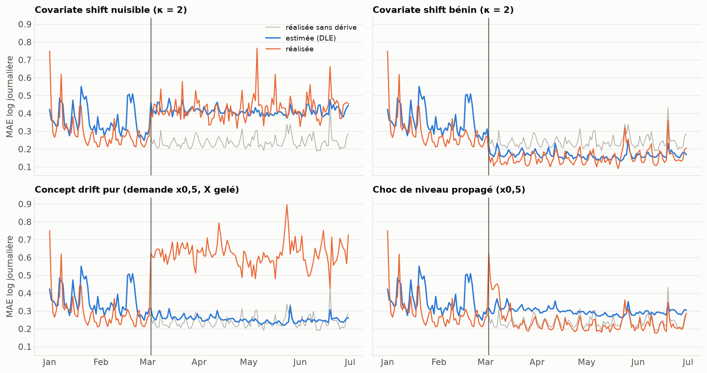
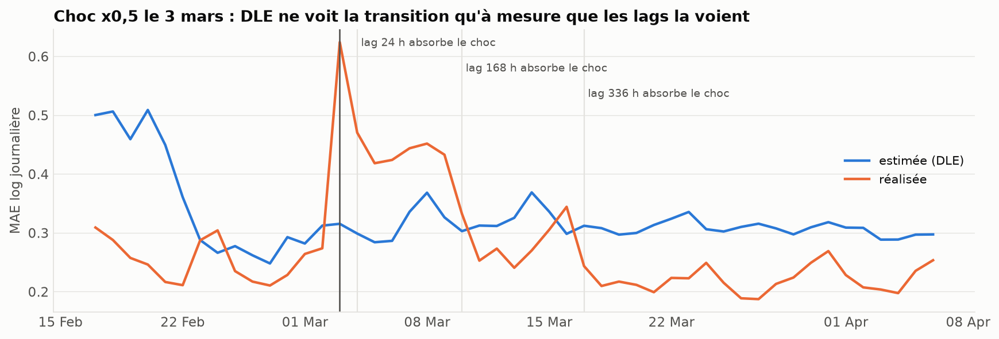

::: {.callout-note appearance="minimal"}
Script : `uv run python -m zonefleet.experiments.e3_frontier` (≈ 2 min) · tables :
`results/tables/e3_summary.csv`, `e3_daily.csv` · modèle 2024 figé, référence sept.-déc.
2024, analysis janv.-juin 2025 (calme d'après E2), injection le lundi 3 mars 2025.
:::

## La question

E1 a montré que DLE sous-estime pendant le choc COVID, mais un choc réel mélange tout.
Pour **nommer le régime où l'estimation décroche**, il faut des dérives pures, dont on
connaît la nature par construction (voir [types de dérive](../concepts/types-de-derive.qmd)).

| Famille | Construction | Pureté garantie |
|---|---|---|
| Covariate shift **nuisible** | chaque jour après le 3 mars, rééchantillonnage des 1 440 lignes réelles avec poids exp(-κ z), z = `lag_168` standardisé : on sur-représente les situations de faible niveau | P(y \| X) intact (lignes réelles) |
| Covariate shift **bénin** | même chose avec exp(+κ z) : sur-représentation des niveaux élevés | idem |
| Concept drift **pur** | demande réalisée x m sur toutes les lignes, features et prévisions **gelées** | P(X) intacte |
| Choc de niveau **propagé** | demande du panel x m, features recalculées, modèle figé ré-appliqué | aucune : cas réaliste |

Le choix de `lag_168` comme direction du covariate shift n'est pas arbitraire : sur la
référence, l'erreur relative vaut 0,44 dans le décile de niveau le plus bas et 0,17 dans
le plus haut. C'est l'hétéroscédasticité que DLE exploite.

## Mesure : l'effet injecté, contre un contrefactuel

Comparer « avant » et « après » le 3 mars mélangerait l'effet injecté et l'évolution
naturelle de la période (hiver puis printemps : même sans dérive, l'erreur estimée baisse
de 0,10). Chaque scénario est donc comparé au **scénario sans dérive sur les mêmes jours**.
Le **taux de suivi** vaut (hausse estimée) / (hausse réalisée) : 1 si DLE suit, 0 s'il est
aveugle.

## Le résultat

{#fig-frontier}

::: {.callout-tip}
## Version interactive
Survoler un point pour voir le scénario et son taux de suivi.


:::



::: {.callout-important}
## La frontière, nommée
- **Covariate shift** (nuisible ou bénin) : DLE suit, avec un taux de **0,82 à 0,99**. Il
  voit aussi les dérives qui *améliorent* le modèle, ce que la dérive des entrées seule
  ne sait pas distinguer d'une dégradation.
- **Concept drift pur** : taux de suivi **exactement 0**. DLE ne bouge pas d'un millième,
  et la dérive des entrées non plus (même 3 % de jours en alerte que sans dérive).
  Une chute de 50 % de la demande, invisible pendant toute la fenêtre aveugle.
- **Choc propagé** : suivi **partiel pendant la transition** (0,32 à 0,58), le temps que
  les lags absorbent le choc ; ensuite l'erreur réalisée revient à la normale mais DLE
  reste légèrement haut (il confond « niveau devenu bas » et « zone difficile »).
:::

## Quatre trajectoires

{#fig-series}

- **En haut à gauche**, le cas d'école : l'erreur monte, DLE la suit au jour près.
- **En haut à droite**, la dérive bénigne : les entrées bougent autant, mais l'erreur
  *baisse*, et DLE le dit. Une politique « dérive seule » aurait alerté ici aussi.
- **En bas à gauche**, l'angle mort : l'erreur réalisée triple, l'estimation colle au
  contrefactuel sans dérive.
- **En bas à droite**, le cas réaliste, détaillé ci-dessous.

## Le choc propagé, au ralenti

{#fig-transition}

C'est la **mécanique exacte du décrochage** observé en E1 :

1. **Jour 0** : la demande change, les features non. Du point de vue du modèle et de
   DLE, c'est un concept drift pur. L'erreur réalisée double, DLE ne voit rien.
2. **Jours 1 à 7** : `lag_24`, `lag_48`, `lag_72` basculent ; une partie des entrées
   reflète le nouveau régime, DLE commence à monter.
3. **Jours 7 à 14** : `lag_168` puis `lag_336` basculent ; le modèle (dont `lag_168` porte
   l'essentiel de l'importance) se recale, l'erreur réalisée redescend.
4. **Après** : le modèle, travaillant en log, est quasi invariant au niveau ; l'erreur
   revient à son niveau habituel, mais DLE, qui a appris que « faible niveau » rime avec
   « forte erreur », la surestime légèrement.

## Ce que E3 établit

1. L'hypothèse du SPEC est **confirmée** : la performance estimée sans labels capture le
   covariate shift et **ment sous concept drift pur**, avec une netteté rare (0,85-0,99
   contre 0,00).
2. Pour un forecaster à lags, tout choc brutal **commence** comme un concept drift pur ;
   la fenêtre d'aveuglement dure le temps que les lags absorbent le choc, ici une à
   deux semaines.
3. Conséquence d'architecture : DLE doit être complété par un signal qui ne dépend pas
   de X. Le seul disponible sans labels est la **dérive des prédictions par rapport à un
   proxy externe** (volume de réservations, demande non servie, capteurs) ; à défaut,
   les labels partiels ou précoces (voir le [system design](../system-design.qmd)).
4. Les seuils par défaut de NannyML (référence + 3 écarts-types sur des chunks
   journaliers) n'alertent dans **aucun** de ces scénarios, même pour une hausse
   d'erreur de 60 % : la variabilité jour à jour de la référence est trop forte. Le
   réglage des seuils est l'objet de [E4](e4-backtest.qmd).
