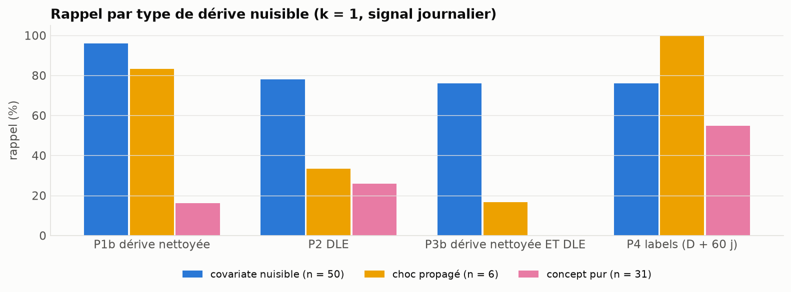
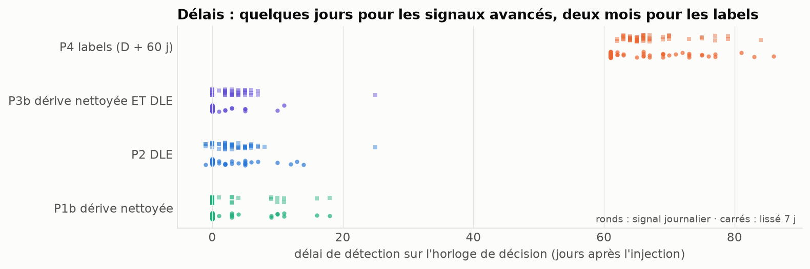
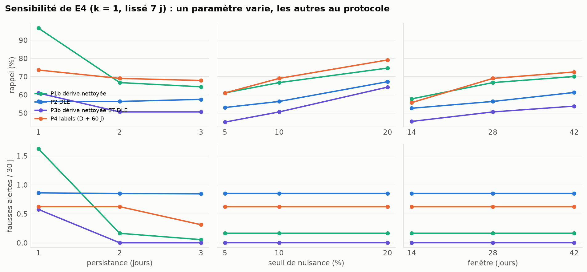

::: {.callout-note appearance="minimal"}
Script : `uv run python -m zonefleet.experiments.e4_backtest` (≈ 11 min) · tables :
`results/tables/e4_*.csv` · modèle 2024 figé, référence sept.-déc. 2024, injections dans
l'analysis calme janv.-juin 2025 · scores par ligne réutilisant les modèles NannyML
(`rowscore.py`, égalité testée).
:::

## Pourquoi tester le moniteur

Un moniteur est un classifieur binaire (« le modèle va-t-il mal ? ») qui tourne tous les
jours. Comme tout classifieur, il a un rappel, un taux de fausses alertes et un délai.
Ne pas les mesurer, c'est brancher sur une astreinte un système dont on ignore s'il
détecte quoi que ce soit, et combien de nuits il fera perdre. C'est le cadre de
[DriftGuard](../veille/driftguard.qmd) (rappel x délai), transposé à une vérité terrain
qui arrive 60 jours trop tard.

## Protocole

| Élément | Choix |
|---|---|
| Scénarios | 240, tirés au hasard (graine fixée) : aucune dérive (42), covariate nuisible (50), covariate bénin (44), concept pur (49), choc propagé (55) |
| Paramètres tirés | intensité (κ de 0,25 à 2 ; facteur de 0,5 à 0,95), sous-ensemble (ville, CBD, hors CBD, soir, nuit), date de début (3 février au 15 mai 2025) |
| Nuisible | MAE log réalisée en hausse de **plus de 10 %** sur les 28 jours suivants, par rapport au contrefactuel sans dérive |
| Détection | un **allumage** d'alerte (front montant, après 2 jours de persistance) sur un jour cible des 28 jours suivant l'injection ; une alarme déjà allumée ne détecte rien |
| Délai | sur l'**horloge de décision** : veille du jour cible pour les signaux avancés, jour cible + 60 jours pour les labels |
| Fausses alertes | allumages sur les jours sans dérive (avant l'injection, et scénarios nuls), par 30 jours ; plus la part de ces jours passés en alerte |
| Seuils | DLE et réalisé : moyenne + k écarts-types des jours de référence, k de 0,5 à 3 ; PCA : seuil NannyML ; PSI : 0,25 |
| Variantes | signal journalier brut, ou lissé sur 7 jours |

Les politiques comparées sont décrites dans [politiques d'alerte](../concepts/politiques-alerte.qmd).
P1b et P3b (« dérive nettoyée » : PCA ou PSI sur `lag_24` et `lag_168` seulement) ont été
**déclarées avant l'exécution** (notes du 15 juillet), après les artefacts relevés en E1/E2.

## Qui est réellement nuisible ?

{#fig-harm}

87 scénarios sont nuisibles : 50 covariate shifts, 31 concept drifts, 6 chocs propagés.
Cette répartition est elle-même un résultat : sur un modèle à lags, **un choc de niveau
propagé est rarement nuisible sur 28 jours** (il ne l'est qu'une semaine ou deux), alors
qu'un concept drift l'est souvent et longtemps.

## Résultats à k = 1



::: {.callout-important}
## Ce que dit le tableau
- **P1, la dérive seule (toutes features)**, est inutilisable : en alerte **100 % des
  jours**, elle ne peut plus rien détecter. La température et la moyenne glissante sur
  7 jours suffisent à la saturer.
- **P1b, la dérive nettoyée**, détecte beaucoup (67 %) avec peu de fausses alertes, mais
  alerte sur **55 %** des dérives *bénignes* : elle ne sait pas si le modèle va mieux ou
  plus mal.
- **P2, DLE seul**, détecte 56 % des nuisibles, mais avec **1,2 fausse alerte par mois**
  (les vagues de froid de l'hiver 2025, vues en E2) et 14 % des jours sans dérive en alerte.
- **P3b, dérive nettoyée ET DLE**, est la seule politique à **zéro fausse alerte** ; elle
  perd 11 points de rappel par rapport à DLE seul (45 % contre 56 %), en récupère 6 avec
  le lissage sur 7 jours (51 %), pour un délai médian de 3 jours.
- **P4, les labels**, détecte le plus (70 %), avec un délai médian de **61 jours**.
:::

::: {.callout-warning}
## Limite de l'intervalle sur les fausses alertes
Les intervalles bootstrap rééchantillonnent les scénarios. Or les jours « sans dérive »
proviennent tous de la **même période réelle** (janvier-juin 2025) : ils ne sont pas
indépendants d'un scénario à l'autre. L'incertitude sur le taux de fausses alertes est
donc **sous-estimée** ; il faudrait d'autres années calmes pour la mesurer vraiment.
C'est l'objet de la [réplication sur trois périodes calmes](#réplication-sur-trois-périodes-calmes-e4-ter)
plus bas.
:::

## Le compromis selon le seuil

{#fig-tradeoff}

::: {.callout-tip}
## Version interactive (signal lissé 7 jours)
Survoler pour lire k, le rappel, les fausses alertes et le délai.


:::

Pour DLE seul, aucun seuil n'atteint à la fois un rappel de 50 % et moins d'une fausse
alerte par mois en signal journalier ; le lissage sur 7 jours rapproche le compromis. Pour
la condition jointe, le seuil le plus bas (k = 0,5) donne **54 % de rappel sans fausse
alerte** (56 % lissé) : la dérive nettoyée sert de filtre, DLE de juge.

## Par type de dérive



{#fig-kind}

- Sur les **covariate shifts nuisibles**, toutes les politiques avancées détectent de
  76 % à 96 % : c'est leur terrain.
- Sur les **concept drifts purs**, les « détections » de P1b (16 %) et P2 (26 %) sont
  **fortuites** : une fausse alerte qui tombe par hasard dans la fenêtre. Leur ordre de
  grandeur suit celui du taux de fausses alertes de chaque politique ; P3b, qui n'en a
  pas, est à **0 %**, ce qui est la vérité : ces dérives sont invisibles sans labels
  ([E3](e3-frontiere.qmd)).
- **Seuls les labels** voient le concept drift (55 %), deux mois plus tard.

Conséquence : le **plafond de rappel** des signaux avancés est fixé par la part de concept
drift parmi les dérives nuisibles. Ici, 31 sur 87 : aucune politique sans labels ne peut
dépasser environ 64 % de rappel *honnête*.

## Délais

{#fig-delays}

## Choisir par le coût

Aucune politique ne domine sur tous les critères. Le notebook
[coût des alertes](../notebooks/couts-alerte.ipynb) donne un prix à chaque erreur
(fausse page, dégradation manquée, jour de retard) et cherche l'optimum : la dérive
nettoyée seule gagne tant qu'une fausse page coûte moins de 7,5 % d'une dégradation
manquée, la condition jointe au-delà, et les labels jamais.

## Ce que E4 établit

1. **Alerter sur la dérive seule est intenable** si l'on n'a pas nettoyé les features :
   alarme permanente. Nettoyée, elle reste bavarde sur les dérives bénignes.
2. **La condition jointe nettoyée (P3b) est la seule politique sans fausse alerte**, au
   prix d'environ 10 points de rappel sur DLE seul ; c'est la politique d'**astreinte**.
3. **Le lissage sur 7 jours** améliore le rappel de la condition jointe (45 % → 51 %)
   pour 3 jours de délai : le bon réglage pour un positionnement de flotte quotidien.
4. **Le concept drift fixe un plafond** que seuls des labels plus rapides peuvent percer :
   c'est l'argument d'architecture principal du [system design](../system-design.qmd).

## Sensibilité au protocole

Trois choix du protocole ont été fixés a priori : persistance de 2 jours, nuisance à
+10 %, fenêtre de 28 jours. `e4_sensitivity.py` les fait varier un par un, sur les
signaux journaliers déjà calculés (aucune injection relancée), au réglage retenu
(k = 1, signal lissé 7 jours).

{#fig-sensitivity}

Condition jointe nettoyée (P3b) :



- **La persistance est le paramètre critique.** À 1 jour, P3b perd sa propriété
  principale (0,58 fausse alerte par mois au lieu de 0) et P1b passe à 1,6. À 2 ou
  3 jours, P3b reste à zéro : 2 jours est le minimum qui tient, 3 n'apporte rien sauf
  un jour de délai.
- **Le seuil de nuisance et la fenêtre** déplacent les rappels de toutes les politiques
  ensemble (plus la nuisance exigée est forte, plus elle est facile à détecter), sans
  changer leur ordre ni les taux de fausses alertes.
- Le classement de E4 tient sur toute la grille : P3b est la seule politique sans
  fausse alerte dès que la persistance atteint 2 jours.

## Réplication sur trois périodes calmes (E4 ter)

La principale limite du backtest est de mesurer les fausses alertes sur une seule période
réelle. E4 ter (extension, issue #59) ajoute deux découpages sans choc connu, avec un
modèle entraîné de janvier à avril et une référence de mai à août : analysis
septembre-décembre 2019 et septembre-décembre 2024. Aucune injection : on observe les
politiques telles quelles, au réglage retenu (k = 1, signal lissé 7 jours), et on les
confronte à la dégradation **réelle** mesurée par les labels.



- **La condition jointe nettoyée ne déclenche sur aucune des trois périodes** : le
  « zéro fausse page » de E4 se réplique.
- **Mais « calme » ne veut pas dire « sans dégradation »** : à l'automne, le modèle
  entraîné au printemps se dégrade pendant les fêtes (erreur réalisée au-dessus du seuil
  22 % et 17 % des jours en 2019 et 2024). DLE seul le voit : **chacun** de ses jours
  d'alerte tombe sur une vraie dégradation (précision de 100 %), et il en couvre 38 à
  41 %. La dérive nettoyée, elle, ne bouge pas : les lags ne se déplacent pas pendant
  les fêtes, la condition jointe reste muette.
- En 2025 au contraire, la précision de DLE seul tombe à 22 % (vagues de froid).

Conséquence d'architecture, reprise dans le [system design](../system-design.qmd) : la
condition jointe reste la règle de **page**, mais une alerte de DLE seul persistante ne
doit pas être jetée ; elle ouvre un **ticket** « dégradation probable sans dérive des
lags » (saison, fêtes, météo extrême), revu le jour ouvré suivant.
