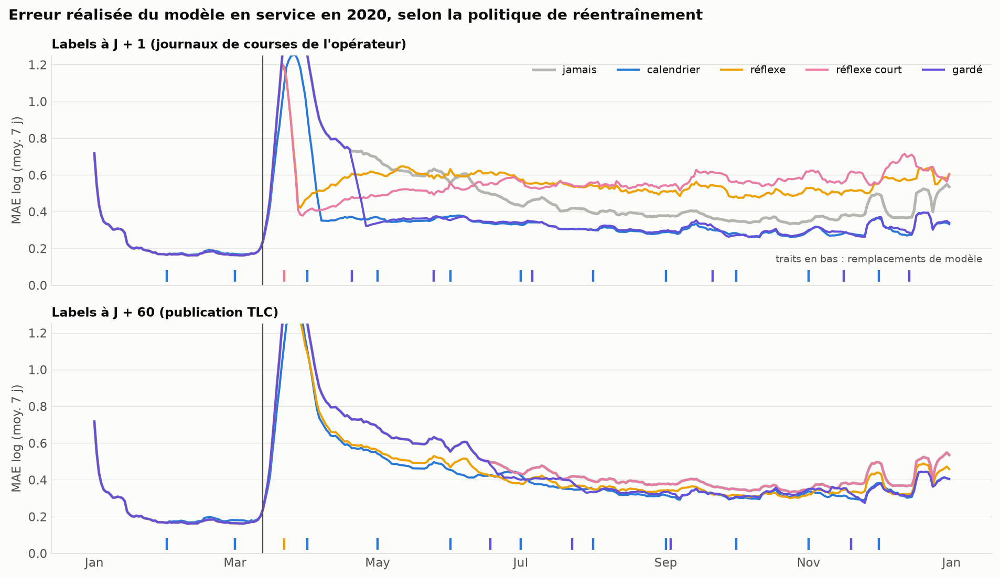
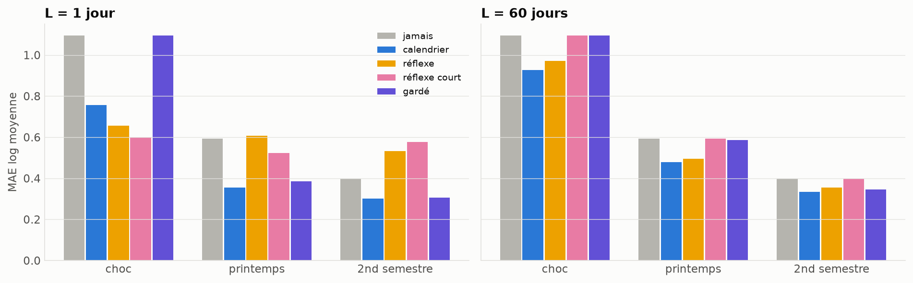
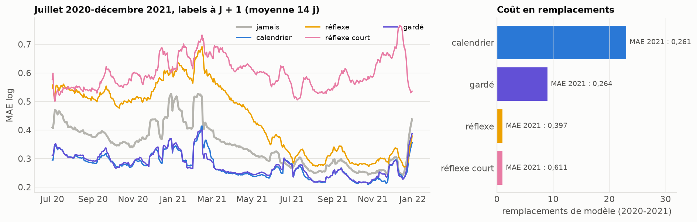

::: {.callout-note appearance="minimal"}
Script : `uv run python -m zonefleet.experiments.e5_retraining` (≈ 10 min) · tables :
`results/tables/e5_*.csv` · champion de départ : le modèle de E1 (entraîné janv.-août
2019), rejoué jour par jour sur toute l'année 2020.
:::

## La question

Une alerte a sonné. Faut-il réentraîner ? Le plan du projet pose deux règles : ne pas
réentraîner **par réflexe**, et seulement si la dérive est confirmée **et** qu'il existe
assez de nouveaux labels. E5 les met à l'épreuve sur le choc le plus violent des données.

## Les politiques

| Politique | Règle | Remplacements (L = 1 / L = 60) |
|---|---|---|
| jamais | le modèle de 2019 reste en service | 0 / 0 |
| calendrier | réentraînement le 1er de chaque mois sur les 8 derniers mois de labels disponibles | 11 / 11 |
| réflexe | réentraînement dès la première alerte P3 de E1 (décision du 22 mars), sur 8 mois de labels | 1 / 1 |
| réflexe court | même date, sur les **seuls** labels postérieurs au 13 mars | 1 / 0 |
| gardé | dérive confirmée ET ≥ 28 jours de labels post-alerte ; challenger hebdomadaire, promu s'il bat le champion de 5 % sur les 14 derniers jours de labels | 6 / 4 |

Deux délais de labels :

- **L = 60 jours** : la publication TLC, le cas du projet ;
- **L = 1 jour** : les journaux de courses propres à un opérateur, le cas réaliste pour
  ZoneFleet, qui connaît ses courses le lendemain.

Garde-fou testé : aucun modèle n'est entraîné sur un label postérieur à
`décision - L` (`tests/test_retraining.py`).

## Résultats

{#fig-traj}



{#fig-periods}

## Lecture

### 1. Le réflexe fait pire que ne rien faire

Avec L = 1, le réentraînement réflexe du 22 mars mélange huit mois de « vieux monde » et
quelques jours de confinement. Il soulage le pic du choc (0,66 contre 1,10), puis reste
**coincé** : sur le second semestre, 0,53 contre 0,40 pour le modèle jamais réentraîné,
qui a fini par être rattrapé par ses propres lags. Sur la période complète, le réflexe
(0,565) est **plus mauvais que l'inaction** (0,524).

Avec L = 60, c'est encore plus net dans le principe : le 22 mars, les derniers labels
publiés datent du 22 janvier. Réentraîner « en réaction au choc » revient à apprendre
**l'ancien monde** une deuxième fois.

### 2. Huit jours de labels, c'est apprendre le bruit

Le « réflexe court » n'apprend que sur les huit jours de labels postérieurs au 13 mars.
Pendant le choc, il est le meilleur (0,60) : il colle au régime de confinement. Ensuite,
la ville rouvre progressivement, et le modèle reste figé sur les pires semaines :
**0,58 au second semestre**, la pire politique de l'année. C'est la règle « réentraîner
sur trop peu de données peut empirer les choses », mesurée.

### 3. La politique gardée évite les accidents

Avec L = 1, la politique gardée ne fait rien pendant le choc (elle attend 28 jours de
labels post-alerte : 1,10 comme l'inaction), puis promeut un challenger le 20 avril et
rejoint le meilleur niveau : **0,31 au second semestre**, avec 6 remplacements, chacun
justifié par une validation sur des labels postérieurs à l'entraînement.

### 4. Le calendrier mensuel est un adversaire sérieux

Résultat qui n'était pas prévu : avec des labels rapides, **le réentraînement mensuel
planifié est la meilleure politique sur l'année** (0,363 contre 0,411 pour la politique
gardée), parce qu'il commence à s'adapter dès le 1er avril sans attendre de confirmation.
Avec L = 60, il reste en tête (0,436), le retard des labels pénalisant tout le monde.

Ce n'est pas une contradiction de la règle « ne pas réentraîner par réflexe » : le
calendrier n'est pas déclenché par l'alerte, il réentraîne **toujours sur la plus grande
fenêtre disponible**, ce qui le protège du sur-apprentissage du réflexe court. Mais il a
deux coûts que ce tableau ne montre pas :

- **11 remplacements par an quoi qu'il arrive**, y compris en régime calme (E2 a montré
  que 2025 n'en demandait aucun) ; chaque remplacement est un changement de production
  non motivé, à valider et à surveiller ;
- **aucun garde-fou** : un mois de données corrompues ou pilotées par le modèle lui-même
  (boucle de rétroaction) entre automatiquement dans le prochain champion.

## Le garde-fou contre les boucles de rétroaction

Le risque propre au forecasting de flotte (voir [Sculley](../veille/sculley.qmd)) : le
modèle positionne les véhicules, les véhicules conditionnent les courses servies, les
courses servies deviennent les labels du modèle suivant. Une zone sous-prévue reçoit
moins de véhicules, sert moins de courses, et sera encore moins prévue.

`ops.decisions.retrain_decision` encode trois conditions cumulatives : dérive confirmée,
≥ 28 jours de labels post-alerte, et **fenêtre de labels non pilotée à 100 % par le
modèle** (`feedback_guard_ok`). Les moyens de satisfaire la troisième sont décrits dans
le [system design](../system-design.qmd) : zones témoins à positionnement indépendant,
journal de la demande non servie, exploration minimale.

## Ce que E5 établit

1. **Ne jamais réentraîner par réflexe** : sur un choc réel, c'est pire que l'inaction.
2. **Le délai des labels décide de tout** : à 60 jours, aucune politique ne peut réagir au
   choc ; à 1 jour, toutes les bonnes politiques convergent en quelques semaines.
3. **Gardé contre calendrier** : la politique gardée est un peu moins performante qu'un
   calendrier mensuel sur cette année exceptionnelle, avec deux fois moins de
   remplacements, chacun validé. Recommandation pour ZoneFleet : politique gardée **plus**
   un réentraînement de fond trimestriel, pour ne pas dépendre uniquement de l'alerte.

## E5 bis : la reprise de 2021

Le verdict « calendrier contre politique gardée » ne reposait que sur 2020, une année
exceptionnelle. Après l'extension du panel à 2021 (issue #61), la même simulation est
prolongée jusqu'au 31 décembre 2021 (issue #63, protocole déclaré avant exécution) :
une année de reprise lente, de sens inverse, sans choc brutal.

{#fig-reprise}



- **Sur 2021, la politique gardée rejoint le calendrier** : MAE log 0,264 contre 0,261
  (L = 1), 0,269 contre 0,270 (L = 60). L'avantage du calendrier tenait au choc de 2020,
  pas à une supériorité de fond.
- **Pour 9 remplacements au lieu de 23** sur deux ans (7 au lieu de 23 à L = 60) :
  chaque remplacement gardé est justifié par une validation sur des labels postérieurs.
- **Le réflexe reste coincé** jusqu'à l'été 2021 (0,397 sur l'année) et le réflexe court
  ne se remet jamais de son apprentissage sur les huit pires jours (0,611).
- **Ne rien faire** devient tenable pendant la reprise (0,320) mais reste 20 % moins bon
  que les deux politiques qui réentraînent.

La recommandation se précise : **politique gardée par défaut**. Le réentraînement de fond
trimestriel ajouté après E5 reste utile comme filet en cas de choc, mais un calendrier
mensuel n'apporte rien en régime de reprise, sinon 14 remplacements de plus.
