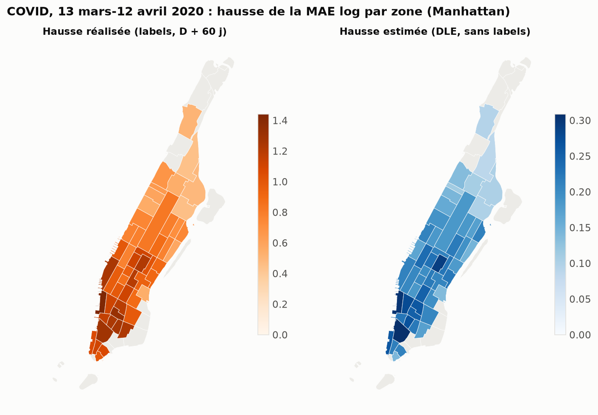
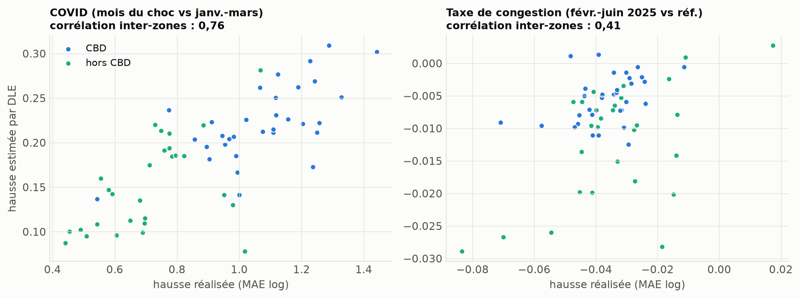
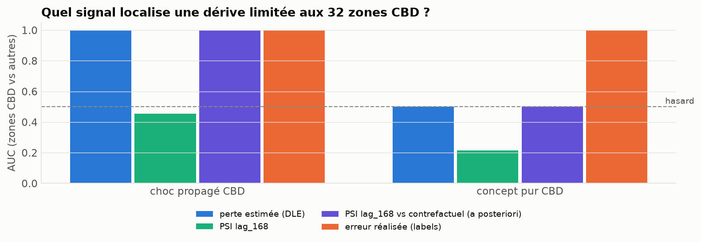

::: {.callout-note appearance="minimal"}
Script : `uv run python -m zonefleet.experiments.e6_localisation` (≈ 10 s) · tables :
`results/tables/e6_*.csv` · protocole déclaré avant exécution dans l'issue #37 ·
une variante ajoutée après coup est signalée comme telle.
:::

## La question

[DriftGuard](../veille/driftguard.qmd) consacre un module entier au **diagnostic** :
une fois la dérive détectée, l'attribuer à un niveau de la hiérarchie (produit, magasin,
région). Pour ZoneFleet, la question est : **quelles zones** ? C'est ce qui décide où
repositionner la flotte à la main, et quelles zones exclure d'un réentraînement.

Les scores par ligne de `RowScorer` (perte estimée par le nanny model, valeur de
`lag_168`, erreur réalisée) se prêtent naturellement à une agrégation par zone.

## Sur le choc réel : le COVID

{#fig-maps}

{#fig-scatter}

Les huit zones les plus dégradées sont toutes dans le CBD, autour des quartiers de vie
nocturne et de bureaux du sud de Manhattan :



**Sans un seul label**, la perte estimée place ces huit zones parmi ses huit premières
sur 60. L'ampleur est fausse (0,2 à 0,3 estimé contre 1,2 à 1,4 réalisé), le
**classement** est juste. Pour un opérateur, c'est la moitié utile de l'information :
savoir où regarder.

## Sur des dérives injectées dans le seul CBD

Deux dérives limitées aux 32 zones CBD, à partir du 3 mars 2025 (facteur 0,6) : un choc
de niveau propagé et un concept drift pur. Pour chaque signal, l'AUC mesure s'il classe
les zones CBD au-dessus des autres (1 = localisation parfaite, 0,5 = hasard).



{#fig-auc}

- **Perte estimée (DLE)** : localisation **parfaite** du choc propagé (AUC 1,00),
  **hasard** pour le concept drift (0,50). La frontière de [E3](e3-frontiere.qmd) se
  retrouve à la maille de la zone.
- **PSI brut de `lag_168`** : il **échoue** à localiser le choc (0,46) et classe même le
  concept drift à l'envers (0,21). La comparaison oppose janvier-février à mars : la
  saison déplace toutes les zones, et le choc x0,6 ramène les zones CBD vers leur niveau
  d'hiver, ce qui **réduit** leur PSI.
- **PSI rapporté au contrefactuel** (variante ajoutée après coup, voir les notes du
  23 juillet) : localisation parfaite (1,00). En production, il n'existe pas de
  contrefactuel ; l'équivalent est une **base saisonnière** (mêmes semaines de l'année
  précédente) plutôt qu'une référence fixe.
- **Erreur réalisée** : localise tout, deux mois plus tard.

## Ce que E6 établit

1. La perte estimée est un bon **outil de diagnostic** : elle classe les zones touchées
   correctement, même quand elle se trompe sur l'ampleur.
2. Le PSI par zone contre une référence fixe est **inutilisable pour localiser** en
   présence de saisonnalité ; il faut une base saisonnière.
3. Le concept drift reste invisible zone par zone : localiser n'est pas détecter.
4. Pour le runbook d'astreinte : après une page, la première action est la **carte de
   perte estimée par zone**, pas la carte de dérive.
