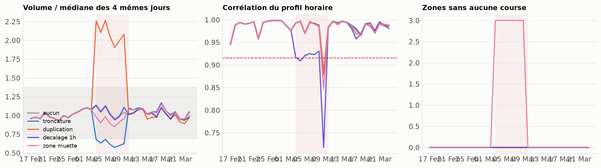

::: {.callout-note appearance="minimal"}
Script : `uv run python -m zonefleet.experiments.e8_quality` (≈ 25 s) · tables :
`results/tables/e8_*.csv` · protocole déclaré dans l'issue #72 · contrôles :
`zonefleet.quality`.
:::

## La question

Sculley et al. demandent de surveiller les **producteurs de données amont** et de
propager leurs alertes au système ML (section 7, *up-stream producers*). Un bug de
données produit exactement les symptômes d'une dérive : volume anormal, profil horaire
déformé, zone qui s'effondre. Qui le voit en premier, et que se passe-t-il si personne ne
le voit ?

## Les contrôles de qualité

Trois indicateurs journaliers sur le panel, comparés aux quatre mêmes jours de semaine
précédents (`quality.daily_checks`) :

| Indicateur | Ce qu'il voit |
|---|---|
| volume du jour / médiane des 4 mêmes jours | fichier tronqué, doublons |
| corrélation du profil horaire ville | décalage horaire, heures manquantes |
| nombre de zones sans aucune course | zone non transmise, jointure cassée |

Deux choix de conception, appris en route :

- **Le calendrier connu est exclu.** Sur 2024-2025, tous les jours extrêmes étaient des
  fêtes (Nouvel An, Memorial Day, 4 juillet, Juneteenth, Thanksgiving, Noël) ; aucune
  anomalie réelle dans les fichiers TLC. Les jours fériés, leurs veilles et lendemains,
  et la semaine du 24 décembre au 1er janvier ne sont pas signalés.
- **Les seuils sont calibrés sur 2024** (quantiles 0,5 % et 99,5 % des jours ordinaires) :
  volume entre 0,68 et 1,38 fois la médiane, corrélation du profil au-dessus de 0,915.
  Sur le premier semestre 2025 sans bug, 4 jours sur 181 sont signalés, dont le 9 mars
  (passage à l'heure d'été) et le 9 février (Super Bowl).

## Quatre bugs injectés

Du lundi 3 au dimanche 9 mars 2025 : **troncature** (40 % des courses perdues),
**duplication** (volumes doublés), **décalage d'une heure**, **zone muette** (trois zones
CBD à zéro). Features et prévisions sont recalculées sur le panel bogué, comme en
production.

{#fig-quality}



## Lecture

- **Les contrôles de qualité voient tout, tout de suite** : premier signal le 3 mars pour
  trois bugs, le 4 mars pour le décalage d'une heure (le profil est déformé mais reste
  assez corrélé le premier jour).
- **Le moniteur de modèle ne voit presque rien.** DLE et la condition jointe restent
  muets : la perte estimée bouge à peine (0,27 à 0,31 contre 0,28 sans bug). Seule la
  dérive nettoyée réagit à la duplication, à partir du 6 mars, quand les lags ont
  absorbé les volumes doublés.
- **Pourtant l'erreur réalisée explose** : 0,59 au lieu de 0,24 pendant la semaine
  dupliquée. Dans deux mois, les labels déclencheraient une alerte réalisée qui
  **accuserait le modèle**, et un réentraînement apprendrait sur des données corrompues.
- La surprise envisagée (un bug invisible aux contrôles mais vu par la condition jointe)
  ne se produit pas.

## Ce que E8 établit

1. **Les contrôles de qualité doivent passer avant le moniteur de modèle**, et bloquer
   les signaux du jour quand ils échouent : c'est l'ordre de l'arbre de décision du
   [runbook](../exploitation/runbook.qmd) (contrat de données d'abord).
2. Un bug de données est **invisible pour la performance estimée** (les entrées restent
   plausibles) et **dévastateur pour la performance réalisée** et pour tout réentraînement
   qui inclurait la période : la fenêtre doit être marquée et exclue.
3. Des contrôles simples, comparés aux mêmes jours de semaine et conscients du
   calendrier, suffisent ; leur coût est de quelques fausses alertes par semestre.
