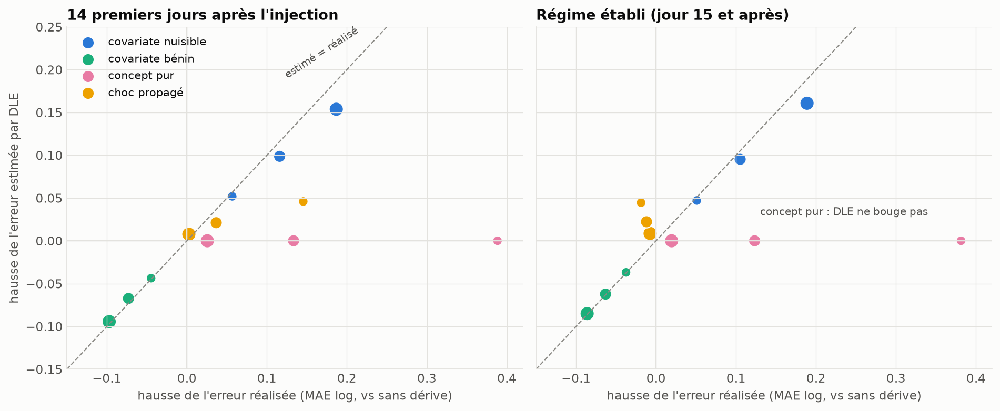

::: {.lead-question}
Peut-on mesurer la santé d'un modèle de prévision **pendant la fenêtre aveugle**, avant
l'arrivée des labels, et savoir **où cette mesure devient un mensonge** ?
:::

Ce site documente un projet complet sur données réelles : un forecaster de demande de
taxis par zone et par heure (New York, 2019-2021 et 2024-2025), figé puis observé à
travers deux chocs réels (le COVID, la tarification de congestion) et des centaines de
dérives injectées. Le client, **ZoneFleet**, est fictif ; les chiffres ne le sont pas.



## La réponse courte

La **performance estimée sans labels** (NannyML DLE) suit l'erreur réelle quand les
entrées du modèle se déplacent vers des régions où il se trompait déjà davantage
(*covariate shift*). Elle est **strictement aveugle** quand c'est la relation entre
entrées et demande qui change (*concept drift*). Pour un forecaster à lags, tout choc
brutal commence par un concept drift, le temps que les lags l'absorbent.

{#fig-home fig-alt="Deux nuages de points, 14 premiers jours après l'injection et régime établi : hausse de l'erreur réalisée en abscisse, hausse estimée par DLE en ordonnée, un point par scénario coloré par famille, avec la diagonale. Les covariate shifts nuisibles et bénins sont sur la diagonale ; les concepts purs restent à zéro en ordonnée jusqu'à près de 0,4 en abscisse ; les chocs propagés sont proches de zéro."}

D'où l'architecture recommandée : **contrôler la qualité des données d'abord** (un bug
amont est invisible pour le moniteur de modèle), **alerter sur la condition jointe**
« dérive des entrées ET hausse de la perte estimée » (zéro fausse alerte sur quatre
périodes réelles et 240 scénarios), garder la dérive seule et la perte estimée seule pour
des tickets, **raccourcir le délai des labels** pour couvrir l'angle mort, et **ne jamais
réentraîner par réflexe**.

## Parcourir le site

::: {.grid}

::: {.g-col-12 .g-col-md-6}
### Comprendre
- [Les trois horloges](concepts/trois-horloges.qmd) : émission, cible, label
- [Covariate shift et concept drift](concepts/types-de-derive.qmd)
- [DLE, formalisé et illustré](concepts/dle.qmd)
- [Dérive univariée](concepts/derive-univariee.qmd) et [multivariée](concepts/derive-multivariee.qmd)
- [Choisir la métrique](concepts/metriques.qmd) · [Politiques d'alerte](concepts/politiques-alerte.qmd)
:::

::: {.g-col-12 .g-col-md-6}
### Mesurer
- [E0](modele/e0.qmd) : le modèle surveillé, avant la dérive
- [E1](experiences/e1-covid.qmd) : le choc COVID, estimé contre réalisé
- [E2](experiences/e2-congestion.qmd) : la taxe de congestion, une dérive sans impact
- [E3](experiences/e3-frontiere.qmd) : la frontière où l'estimation ment
- [E4](experiences/e4-backtest.qmd) : 240 dérives pour tester le moniteur
- [E5](experiences/e5-reentrainement.qmd) : réentraîner, mais pas par réflexe
- [E6](experiences/e6-localisation.qmd) : localiser la dérive par zone
- [E7](experiences/e7-saisonnier.qmd) : comparer chaque jour à sa propre saison
- [E8](experiences/e8-qualite.qmd) : quand ce sont les données qui mentent
- [E9](experiences/e9-meteo.qmd) : la vraie prévision météo de la veille
:::

::: {.g-col-12 .g-col-md-6}
### Décider
- [System design](system-design.qmd) : l'architecture en dix lignes
- [Cas client ZoneFleet](zonefleet.qmd) : cahier des charges et recommandations
- [Dagster](mlops/dagster.qmd) et [MLflow](mlops/mlflow.qmd) : la mise en production
- [Runbook](exploitation/runbook.qmd), [rapport du matin](exploitation/rapport.qmd), [ADR](exploitation/adr.qmd)
:::

::: {.g-col-12 .g-col-md-6}
### Approfondir
- Veille : [NannyML](veille/nannyml.qmd), [DriftGuard](veille/driftguard.qmd), [Sculley et al.](veille/sculley.qmd)
- Données : [sources](donnees/sources.qmd), [data contract](donnees/data-contract.qmd), [panel](donnees/panel.qmd)
- Notebooks : [DLE pas à pas](notebooks/tutoriel-dle.ipynb), [coût des alertes](notebooks/couts-alerte.ipynb)
- [Méthode](methode.qmd) · [Journal de bord](journal.qmd) · [Rétrospective](retrospective.qmd) · [Références](references.qmd) · [Glossaire](glossaire.qmd) · [FAQ](faq.qmd)
:::

:::

## Reproduire

```bash
git clone https://github.com/gwils28/zonefleet-observability && cd zonefleet-observability
uv sync --all-extras
make check            # lint + tests
make e0 e1 e2 e3      # le panel agrégé est versionné : pas besoin des 3 Go de données brutes
make e4 e5 e6 e7 e8 e9   # ≈ 25 min (E5 bis : make e5r, ≈ 25 min de plus)
make figures site
```

Le protocole est figé dans [`SPEC.md`](https://github.com/gwils28/zonefleet-observability/blob/main/SPEC.md),
les écarts sont consignés dans
[`docs/notes/implementation.md`](https://github.com/gwils28/zonefleet-observability/blob/main/docs/notes/implementation.md),
et chaque chiffre de ce site est lu dans `results/`.
