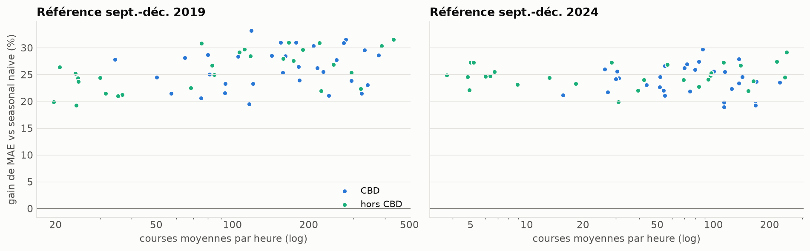

::: {.callout-note appearance="minimal"}
Script : `uv run python -m zonefleet.experiments.e0_model` (≈ 6 min, MSTL inclus) ·
tables : `results/tables/e0_*.csv`.
:::

## Résultats globaux



Lecture :

- **Sur la référence**, LightGBM réduit la MAE de 27 % (E1) et de 24 % (E2) par rapport
  au seasonal naive.
- **MASE > 1 pour le seasonal naive** sur la référence : l'échelle du MASE est figée sur
  l'entraînement (janvier-août), où la demande est plus régulière qu'en automne.
- **Sur l'analysis E1 (COVID)**, la MAE *baisse* (14,0 contre 22,7) alors que la sMAPE
  triple (61,6 % contre 20,5 %) : la dégradation est relative, pas absolue
  (voir [métriques](../concepts/metriques.qmd)). Le seasonal naive y a même une sMAPE
  plus faible : en régime de rupture, le modèle appris n'apporte plus rien.
- **Sur l'analysis E2 (congestion)**, aucune dégradation globale : MAE 14,3 contre 14,9.
  S'il y a un effet, il est local (E2).

## Comparaison avec MSTL

Sur 8 zones représentatives (Astoria, Clinton East, East Harlem North, East Village,
JFK, LaGuardia, Midtown Center, Upper East Side South), MSTL est réajusté **chaque jour**
sur les 8 dernières semaines (`baselines.mstl_rolling`) :



MSTL fait mieux que le seasonal naive et moins bien que LightGBM. La comparaison est
légèrement défavorable à MSTL (horizons de 25 à 48 h au lieu de 24 h exactement), ce qui
ne change pas le classement.

## Par zone

{#fig-zones}

## À quoi ressemblent les prévisions

![Une semaine de référence pour une zone CBD dense et une zone du Queens. La médiane suit bien le cycle ; les pics du soir sont parfois sous-estimés, et l'intervalle [q10, q90] est trop étroit.](../figures/e0_traces.png){#fig-traces}

## Calibration des intervalles

![Couverture empirique de l'intervalle [q10, q90] par heure : entre 66 % et 76 %, sous la cible de 80 %, avec un creux à la pointe du matin.](../figures/e0_couverture_heure.png){#fig-cov}

La couverture globale est de 72 % sur les deux références. Ce défaut est **assumé et
documenté** plutôt que corrigé : la conformalisation des quantiles est hors périmètre
(SPEC, section 9). Pour le monitoring, il a une conséquence utile : la couverture
réalisée devient un indicateur de santé à part entière, comparé à **sa** valeur de
référence (72 %), pas à la valeur nominale (80 %).

## Ce que E0 établit pour la suite

1. Le modèle est **bon et homogène** : une dégradation future ne pourra pas être mise
   sur le compte d'une faiblesse initiale localisée.
2. Ses erreurs sont **hétéroscédastiques** (plus fortes aux pics, dans les zones denses) :
   c'est la condition 3 de DLE, satisfaite.
3. Sa dépendance au lag hebdomadaire fixe l'**inertie** attendue après un choc : environ
   une semaine.
