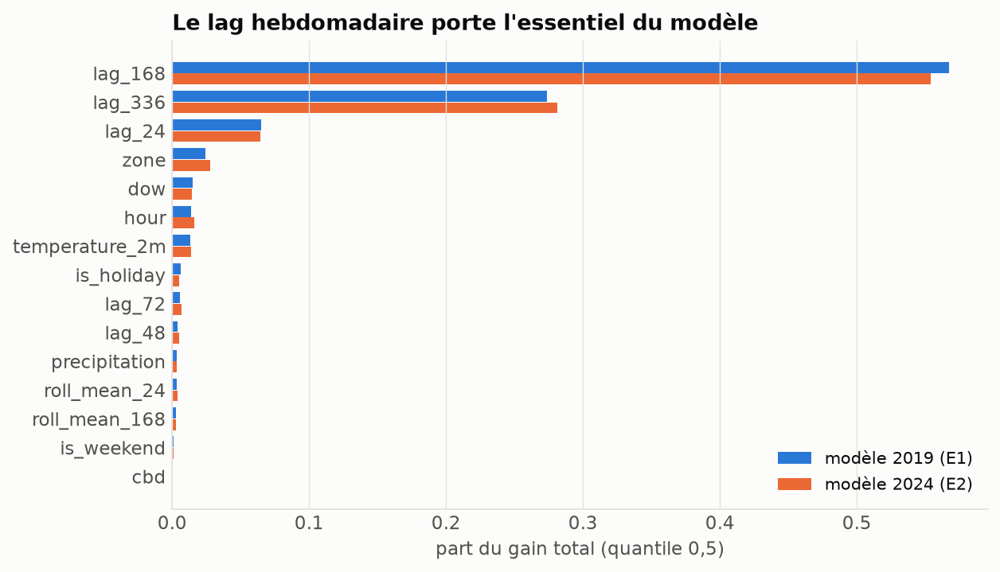

## Pourquoi ce modèle

Le projet ne cherche pas le meilleur forecaster : il cherche un forecaster **réaliste**,
du type de ceux qui tournent en production chez un opérateur de flotte, pour l'observer
vieillir. Un modèle global de gradient boosting sur lags et calendrier est le standard
de fait de la prévision de demande tabulaire.

```{mermaid}
flowchart LR
  P["panel zone x heure"] --> L["lags 24, 48, 72, 168, 336 h<br/>moyennes 24 h et 168 h<br/>(terminées à t - 24 h)"]
  W["météo"] --> X
  C["calendrier : heure, jour,<br/>week-end, férié"] --> X
  Z["zone (catégorielle), CBD"] --> X
  L --> X["matrice X<br/>17 features"]
  X --> Q1["LightGBM q = 0,1"]
  X --> Q2["LightGBM q = 0,5"]
  X --> Q3["LightGBM q = 0,9"]
  Q1 & Q2 & Q3 --> S["tri par ligne (pas de croisement)<br/>expm1, plancher à 0"]
  S --> O["q10, q50, q90<br/>en courses"]
```

## Les features

| Groupe | Features | Connu à l'émission τ ? |
|---|---|---|
| Lags de demande | `lag_24`, `lag_48`, `lag_72`, `lag_168`, `lag_336` (sur log1p) | oui, par construction |
| Moyennes glissantes | `roll_mean_24`, `roll_mean_168`, terminées à t - 24 h | oui |
| Calendrier | `hour`, `dow`, `is_weekend`, `is_holiday` | oui |
| Météo | `temperature_2m`, `precipitation` | hypothèse : prévision parfaite |
| Zone | `zone` (catégorielle), `cbd` | oui |

Les lags sont calculés **par zone et par bloc contigu** (le panel saute de 2020 à 2024) :
aucun lag ne traverse une frontière de zone ou le trou de trois ans. Trois tests le
garantissent (`tests/test_features.py`).

## La feature que nous avons retirée

Le premier modèle incluait la saison (`doy_sin`, `doy_cos`). Entraîné de janvier à août,
il voyait sur la référence (septembre à décembre) des valeurs de saison **jamais
rencontrées** : un covariate shift créé par une feature, sans aucun rapport avec le monde.

| Variante (référence E1) | MAE | Couverture 80 % |
|---|---|---|
| avec `doy_sin`, `doy_cos` | 29,5 | 58 % |
| **sans** (retenue) | **22,7** | **72 %** |

::: {.callout-tip}
## Leçon de monitoring
Une feature qui encode le temps absolu (date, saison, compteur) dérive **toujours** entre
entraînement et production. Elle fait monter la dérive des entrées sans que le monde ait
changé, et pousse le nanny model de DLE hors de son support. La saisonnalité annuelle
passe ici par les lags 168 et 336 h. Décision consignée dans
`docs/notes/implementation.md`.
:::

## Quantiles et figement

- **Trois modèles quantiles** (perte pinball), sur log1p : les quantiles sont équivariants
  par transformation monotone, donc `expm1` des quantiles log donne les quantiles en courses.
- **Tri par ligne** des trois prédictions pour éviter le croisement des quantiles.
- **Hyperparamètres fixés a priori** (500 arbres, taux 0,05, 63 feuilles, 50 observations
  minimum par feuille, sous-échantillonnage 0,8) : aucune recherche, pour ne pas
  sur-ajuster la référence.
- **Figement** : le modèle est sérialisé (`results/cache/models/<split>.pkl`) et n'est
  plus jamais réentraîné dans les expériences de monitoring. Sa date d'entraînement est
  stockée dans l'objet (`trained_on`).

## Importance des features

{#fig-imp}

Le poids écrasant de `lag_168` a une conséquence directe pour le monitoring : après un
choc, le modèle ne « rattrape » le nouveau régime que lorsque le lag hebdomadaire l'a
vu, soit **une semaine** ; il faut deux semaines pour que `lag_336` suive. C'est la durée
de la phase où le modèle se trompe pour une raison que ses entrées ne montrent pas.
